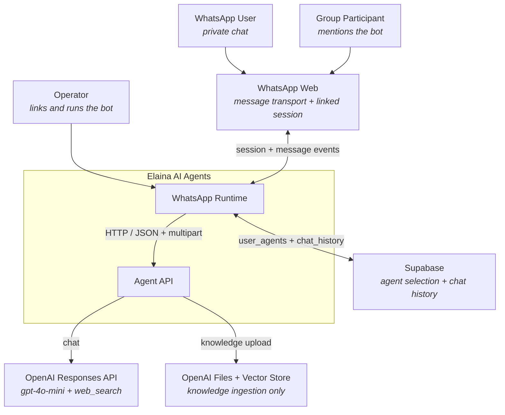
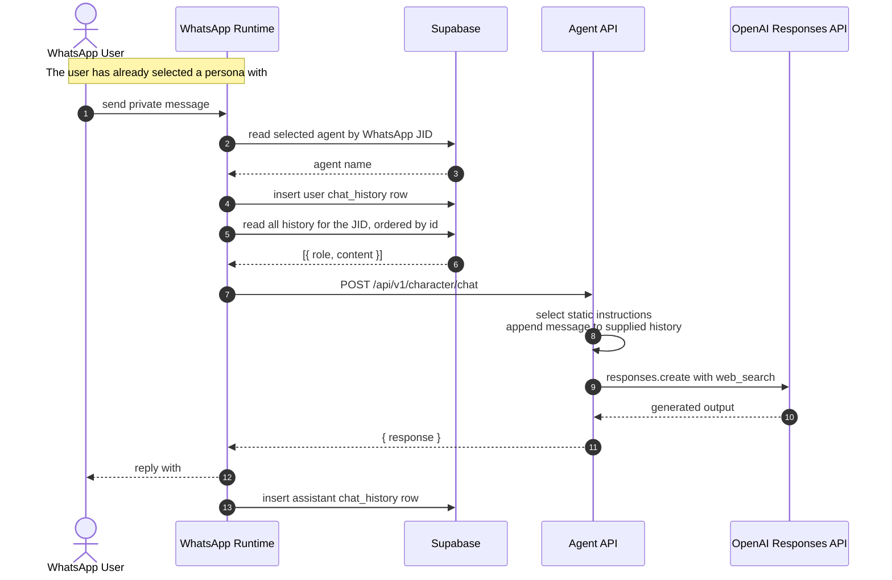

# Elaina — Architecture Documentation

**Elaina is a WhatsApp-first AI assistant with selectable personas,
persistent conversation history, web-enabled responses, and knowledge
upload commands.** Messages enter through WhatsApp Web, pass through a
Node.js WhatsApp runtime, and are answered by an Express Agent API backed by
Supabase and OpenAI.

This repository documents how that system is built at three pinned
source commits. It contains no application code, database migration, or
deployable service — the source lives in
[three repositories](#source-repositories) linked at the end.

---

## The Problem

The organisation profile describes a multi-agent assistant that remembers
conversation context and gives each user an isolated knowledge base. The
implemented system does not yet provide all of those guarantees. It is a
WhatsApp bot with manual persona selection: a user chooses one of four
named agents, the runtime stores that choice in Supabase, and the Agent API
maps the name to a static instruction string before calling OpenAI.

Knowledge can be uploaded, but it is attached to one configured vector
store and is not connected to the observed chat request. That gap is the
central reason for documenting the system as it exists rather than drawing
the omnichannel, tenant-aware platform it may eventually become.

## How It Works

A user selects a persona with `#agent`, then sends a private message or
mentions the bot in a group. The WhatsApp Runtime resolves the selected
agent from Supabase, writes the user message to `chat_history`, reads the
conversation history for the WhatsApp or group JID, and sends the request
to the Agent API.

The Agent API maps the requested agent name to one of four instruction
strings and calls OpenAI `responses.create` with `gpt-4o-mini` and the
`web_search` tool. It returns one text response. The adapter sends that
response to WhatsApp and appends the assistant message to Supabase.

Text and PDF knowledge follow a separate path. The Agent API uploads each
item to OpenAI Files and attaches it to the vector store identified by
`VECTOR_STORE_ID`. The chat route enables web search, but not file search,
so uploaded knowledge does not participate in the observed response flow.

## System at a Glance

## The Three Components

**[WhatsApp Runtime](docs/03-components/whatsapp-runtime.md)** — a
CommonJS Node.js process using `whatsapp-web.js`, LocalAuth, Chromium,
Axios, Express, and Supabase. It owns channel events, command parsing,
agent selection, chat-history persistence, and the relay to the Agent
API.

**[Agent API](docs/03-components/agent-api.md)** — an ESM Node.js and
Express application. It exposes the chat and knowledge routes, calls the
OpenAI Responses API for chat, and sends text and PDF inputs to OpenAI
Files and one configured vector store.

**[Data and Knowledge Boundary](docs/03-components/data-and-knowledge.md)**
— the observed persistence boundary across the Supabase tables, the
WhatsApp LocalAuth profile, OpenAI Files, and the configured vector
store. The source contains no database migrations, Row Level Security
policies, or per-user vector-store isolation.

## The Headline Flow

The private-chat path is synchronous from the incoming WhatsApp event to
the outgoing reply. There is no internal message broker, durable queue,
or stable event contract in the pinned source.

Because the adapter writes the current user message before reading history,
and the API appends that message again, the observed OpenAI input contains
the current message twice. The diagrams preserve that behaviour rather
than silently correcting it. Full walkthroughs of all six flows are in
[docs/04-flows.md](docs/04-flows.md).

## Design Decisions

The system's present shape comes from four implementation choices. The
WhatsApp Runtime owns both channel handling and persistence, so Supabase
is not accessed through the Agent API
([WhatsApp Runtime](docs/03-components/whatsapp-runtime.md)). Agent choice
is explicit and stored per JID; although reusable OpenAI Agents are
defined, the chat endpoint selects a static prompt and calls the Responses
API directly
([Agent API](docs/03-components/agent-api.md)).

Conversation history is sent in full on every chat request, with no
observed bound or summarisation step. Knowledge ingestion uses one
operator-configured vector store, while chat uses `web_search` only. The
result is two separate OpenAI paths rather than retrieval-augmented chat
([Data and Knowledge Boundary](docs/03-components/data-and-knowledge.md)).

This architecture repository also records three accepted documentation
decisions: keep architecture in a separate repository
([ADR 0001](docs/adr/0001-separate-architecture-repository.md)), describe
an as-is snapshot plus future constraints
([ADR 0002](docs/adr/0002-as-is-snapshot-with-future-constraints.md)), and
standardise on C4-style Mermaid and OpenAPI
([ADR 0003](docs/adr/0003-c4-mermaid-and-openapi.md)). All records are
indexed at [docs/adr/](docs/adr/README.md).

## Where This Is Heading

The most consequential next step is not adding another channel. It is
making the current boundary trustworthy: remove committed WhatsApp
session artifacts from the source history, authenticate the Agent API,
scope knowledge by tenant, bound conversation context and upload size,
and make the database contract reproducible.

Only after those controls exist should Elaina add channel adapters,
canonical tenant, actor, and conversation identities, a provider
abstraction, observability, and cost controls. The full set of constraints
is in [docs/08-future-work.md](docs/08-future-work.md).

## Documentation Map

| Document | Answers |
| --- | --- |
| [01-context.md](docs/01-context.md) | Who uses Elaina, and what does it depend on? |
| [02-containers.md](docs/02-containers.md) | What runs, where does state live, and how do the parts communicate? |
| [03-components/whatsapp-runtime.md](docs/03-components/whatsapp-runtime.md) | How does WhatsApp input become an Agent API request? |
| [03-components/agent-api.md](docs/03-components/agent-api.md) | How are chat and knowledge requests handled? |
| [03-components/data-and-knowledge.md](docs/03-components/data-and-knowledge.md) | Where does state live, and what isolation is observed? |
| [04-flows.md](docs/04-flows.md) | What happens, step by step, in each observed scenario? |
| [05-data-model.md](docs/05-data-model.md) | What data is visible, and which fields or policies are unknown? |
| [06-security-model.md](docs/06-security-model.md) | What is trusted, exposed, and missing? |
| [07-deployment.md](docs/07-deployment.md) | What is known about runtime topology and configuration? |
| [08-future-work.md](docs/08-future-work.md) | What constraints govern future omnichannel work? |
| [adr/](docs/adr/README.md) | Why is this documentation repository shaped this way? |
| [contracts/openapi.yaml](contracts/openapi.yaml) | What HTTP interface does the Agent API implement? |
| [contracts/source-snapshots.json](contracts/source-snapshots.json) | Which exact source revisions were inspected? |
| [source-traceability.md](docs/source-traceability.md) | Which pinned files and lines support each claim and contract? |
| [security-remediation-backlog.md](docs/security-remediation-backlog.md) | Which risk-reduction outcomes are ordered by severity? |

## Source Repositories

| Repository | Pinned commit | Role |
| --- | --- | --- |
| [Elaina-AI-Agents/ai-agents](https://github.com/Elaina-AI-Agents/ai-agents/tree/0597bf2ff8e75d09c403f7992a03fe08cba5e0da) | `0597bf2ff8e75d09c403f7992a03fe08cba5e0da` | Express Agent API and agent definitions |
| [Elaina-AI-Agents/whatsapp](https://github.com/Elaina-AI-Agents/whatsapp/tree/cd2f34ae6fe09217d47556b4fec18d429847eb85) | `cd2f34ae6fe09217d47556b4fec18d429847eb85` | WhatsApp adapter and Supabase history client |
| [Elaina-AI-Agents/.github](https://github.com/Elaina-AI-Agents/.github/tree/5689f02df71f517041a0759840daef7da0dc0581) | `5689f02df71f517041a0759840daef7da0dc0581` | Organisation-level stated product intent |

The snapshot was inspected on 2026-08-23. A machine-readable copy is in
[contracts/source-snapshots.json](contracts/source-snapshots.json).

## About This Repository

This repository documents Elaina as it is built at the pinned commits.
Claims about endpoints, environment variables, tables, and runtime gaps
are traceable to those revisions. Database fields, constraints, policies,
and deployment controls that are absent from source are labelled
`unknown` rather than inferred.

[`tools/verify-docs.sh`](tools/verify-docs.sh) provides the same lightweight
placeholder, fence, internal-link, and source-reference checks used by the
reference repository. `npm run validate` adds Markdown linting, external links,
the
OpenAPI contract, Mermaid rendering, source-drift behaviour and coverage,
and secret patterns. The repository intentionally contains no WhatsApp
session data, cookies, tokens, API credentials, or database contents.

## License

[MIT](LICENSE)
