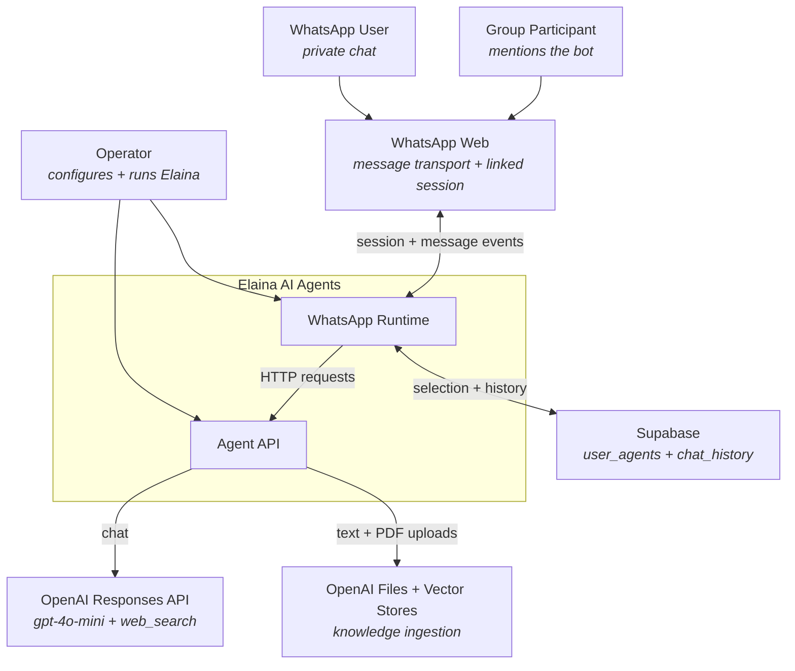

# System Context

Elaina connects people in WhatsApp private chats and groups to an Agent
API that generates persona-based responses through OpenAI. A user selects
the persona explicitly, and the WhatsApp Runtime stores that selection and
the conversation history in Supabase. Knowledge upload exists alongside
chat, but the uploaded material is not used by the observed chat request.

This document is the outermost zoom level. It names who uses the system,
what the system depends on, and where the boundary between the two sits.
For the runtime elements inside and around that boundary, continue to
[02-containers.md](02-containers.md).

## Actors

### WhatsApp User

A person in a private chat who selects an agent with `#agent`, asks for
help with `#help`, chats with the selected persona, and can submit text or
PDF knowledge through command messages. The runtime identifies this actor
by the WhatsApp JID in `message.from`; there is no separate account or
tenant identity in the pinned source.

### Group Participant

A person in a WhatsApp group. Normal chat reaches the Agent API only when
the bot is mentioned. Agent selection and chat history are nevertheless
keyed by the group JID, not by the individual participant, so members of
one group share the observed selection and conversation history boundary.

### Operator

The person who configures and starts both Node.js processes, scans the
WhatsApp QR code, and maintains the LocalAuth and Chromium session on the
WhatsApp host. The operator also supplies the Supabase and OpenAI
configuration. No operator interface, deployment manifest for the
WhatsApp runtime, or operational runbook is present in the pinned source.

## External Systems

### WhatsApp Web

The message transport and linked-device session provider. Elaina reaches
it through `whatsapp-web.js`, an embedded Chromium runtime, and a
persistent LocalAuth profile on the operator-managed host. Availability
and linked-device behaviour remain outside Elaina's control.

### Supabase

Stores two tables observed through client calls: `user_agents` and
`chat_history`. The WhatsApp Runtime connects with `SUPABASE_URL` and
`SUPABASE_ANON_KEY`, upserts the selected persona, appends both sides of a
conversation, and reads history ordered by `id`.

The source contains no database migrations, generated types, constraints,
indexes, retention rules, or Row Level Security policies. Their presence
and exact definitions are therefore `unknown`.

### OpenAI Responses API

Generates the assistant reply. The Agent API calls `responses.create`
with `gpt-4o-mini`, a static instruction string chosen from the requested
agent name, the supplied history, and the `web_search` tool. Although the
organisation profile says GPT-4o, the pinned runtime requests
`gpt-4o-mini`.

### OpenAI Files and Vector Stores

Receive text and PDF knowledge uploads. Each file is created with purpose
`assistants` and attached to the single vector store named by
`VECTOR_STORE_ID`. User identity is stored as file metadata, but the
observed code does not enforce a user-specific store or query filter. The
chat request does not enable `file_search`, so this uploaded material is
not retrieved during chat.

## System Boundary

Inside the boundary — the parts the Elaina source repositories build and
the operator runs:

- **WhatsApp Runtime** — owns channel events, command handling, group
  mention gating, persistence calls, LocalAuth state, and API relay.
- **Agent API** — exposes chat and knowledge endpoints and calls the
  OpenAI services.

Outside the boundary — depended upon, not controlled:

- **WhatsApp Web**, for message transport and linked-device operation.
- **Supabase**, for selected-agent and conversation-history persistence.
- **OpenAI Responses API**, for model output and web search.
- **OpenAI Files and Vector Stores**, for knowledge storage and indexing.

There is no observed web UI, admin UI, identity provider, queue, internal
broker, separate knowledge service, or channel-independent conversation
layer. Those are future architecture questions, not current components.

The distinction matters when reasoning about trust. A caller that can
reach the Agent API crosses directly into model and knowledge operations,
because no service authentication or authorisation is observed. A
WhatsApp or group JID crosses the persistence boundary as the effective
identity even though it is not a canonical tenant or actor identifier.
[06-security-model.md](06-security-model.md) works through those boundaries
in detail.

## Context Diagram

---

Next: [02-containers.md](02-containers.md) — the owned deployables,
managed services, and communication paths.
