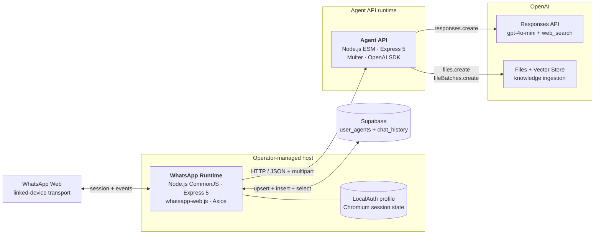

# Containers

Zooming in one level from [01-context.md](01-context.md): the observed
runtime has two Elaina-owned deployables and two managed persistence and
AI service boundaries. The two Node.js processes communicate over HTTP;
there is no internal broker or shared application package.

| Runtime element | Runs where | Job |
| --- | --- | --- |
| **WhatsApp Runtime** | Operator-managed host with Chromium and persistent LocalAuth state | Receive WhatsApp events, parse commands, store selection and history, relay to the API |
| **Agent API** | Node.js Express runtime; a Vercel routing manifest is present | Generate persona-based chat responses and ingest knowledge files |
| **Supabase Persistence** | Supabase-managed PostgreSQL boundary | Store `user_agents` and `chat_history` records |
| **OpenAI Services** | OpenAI-managed APIs | Generate responses, search the web, store files, and index knowledge in a configured vector store |

## WhatsApp Runtime

A CommonJS Node.js application built on Express 5,
`whatsapp-web.js`, LocalAuth, Puppeteer/Chromium, Axios, FormData, and the
Supabase JavaScript client. `index.js` is its single entry point. Its
Express listener uses `process.env.PORT`, defaulting to `3002`, although
no HTTP route is defined in the pinned source.

The runtime owns the WhatsApp QR and ready lifecycle, the `#help`,
`#agent`, `#addtext`, and `#addpdf` command branches, group mention
gating, selected-agent reads and writes, conversation-history reads and
writes, and synchronous calls to the Agent API. LocalAuth and its Chromium
profile make this a stateful operational process even though its business
data is held in Supabase.

Details in
[03-components/whatsapp-runtime.md](03-components/whatsapp-runtime.md).

## Agent API

An ESM Node.js application built on Express 5, Multer, and the OpenAI
JavaScript SDK, with `index.js` as its single entry point. It listens on
`process.env.PORT`, defaulting to `3001`. A Vercel configuration rewrites
all request paths to that entry point; the pinned repositories do not
include live deployment evidence.

It exposes four observed routes:

- `POST /api/v1/character/chat`
- `POST /api/v1/character/add-knowledge/text`
- `POST /api/v1/character/add-knowledge/pdf`
- `GET /api/v1/character/knowledge`

The first three contain work paths. The knowledge-listing endpoint always
returns HTTP `501`. The observed HTTP contract, including current
validation weaknesses and response shapes, is captured in
[contracts/openapi.yaml](../contracts/openapi.yaml).

Details in [03-components/agent-api.md](03-components/agent-api.md).

## Supabase Persistence

The WhatsApp Runtime creates a Supabase client with `SUPABASE_URL` and
`SUPABASE_ANON_KEY`; the Agent API does not access Supabase in the
observed request paths.

`user_agents` is upserted on `user_id` and read to recover the selected
persona. `chat_history` receives `{ user_id, role, content }` rows and is
read for one `user_id`, ordered by `id` ascending, before every chat API
call. The query has no observed limit, pagination, or summarisation step.

Only those fields and operations can be established from the source.
Primary keys, foreign keys, uniqueness constraints, timestamps, indexes,
retention, and Row Level Security policies are `unknown` because no schema
or migrations are included.

Details in
[03-components/data-and-knowledge.md](03-components/data-and-knowledge.md)
and [05-data-model.md](05-data-model.md).

## OpenAI Services

The Agent API creates one OpenAI client from its runtime environment and
uses two independent service paths.

For chat, `responses.create` receives `gpt-4o-mini`, the static
instructions selected for the requested agent, the message or supplied
history, and `tools: [{ type: "web_search" }]`. Agent definitions with
sub-agent tools exist in `agents.js`, but the endpoint does not execute
that orchestration.

For knowledge, the API creates an OpenAI File with purpose `assistants`
and attaches its file ID to the vector store selected by
`VECTOR_STORE_ID`. Both text and PDF files carry user metadata. The chat
path does not configure `file_search`, so the source does not show
knowledge retrieval or per-user knowledge isolation.

Details in
[03-components/data-and-knowledge.md](03-components/data-and-knowledge.md).

## Communication

### WhatsApp Runtime ↔ WhatsApp Web

`whatsapp-web.js` drives a Puppeteer/Chromium session authenticated with
LocalAuth. Incoming `message_create` events start the command or chat
flow; outgoing replies use `client.sendMessage`. LocalAuth state persists
on the operator host.

### WhatsApp Runtime → Agent API

Axios sends JSON for chat and text knowledge, and multipart form data for
PDF knowledge. `AGENT_API_URL` defaults to `http://localhost:3001`. There
is no observed service credential, authorisation header, request signing,
schema negotiation, retry, explicit timeout, or rate limit on this edge.

### WhatsApp Runtime → Supabase

The adapter directly upserts `user_agents`, inserts `chat_history`, and
selects history. Private users are keyed by their WhatsApp JID. Group
messages use the group JID, so selection and history are shared at the
group conversation boundary rather than isolated by participant.

### Agent API → OpenAI Responses API

The chat endpoint makes one synchronous `responses.create` call and reads
the text from the first output item whose type is `message`. It returns
that value in `{ response }`, falling back to a fixed message when no text
is found.

### Agent API → OpenAI Files and Vector Stores

The text and PDF routes first create an OpenAI File, then call
`vectorStores.fileBatches.create` with the configured store ID and the new
file ID. This edge ingests knowledge only; there is no corresponding
file-search edge from the chat flow.

## Container Diagram

## Deployment Coupling

The tightest runtime coupling is the synchronous HTTP edge between the
WhatsApp Runtime and the Agent API. The adapter defaults
`AGENT_API_URL` to `http://localhost:3001` and assumes that chat succeeds
with a JSON body containing `response`; neither side validates a shared
schema at runtime.

Identity is the second coupling point. The adapter supplies a WhatsApp or
group JID as `userId`, and the Agent API trusts caller-supplied user IDs
for knowledge metadata. No canonical tenant, actor, or conversation
identity exists in the pinned source.

Knowledge adds a third configuration dependency: every upload is attached
to the single store named by `VECTOR_STORE_ID`. The source contains no
store-provisioning record, tenant-to-store mapping, or retrieval link back
into chat.

Finally, the two deployables have different operational shapes. The
WhatsApp Runtime requires a long-lived Chromium session and writable
LocalAuth state. The Agent API has a Vercel manifest but also calls
`app.listen`; no infrastructure definition confirms where either process
runs in production. [07-deployment.md](07-deployment.md) documents what is
observed and labels the rest `unknown`.

---

Next: the component documents —
[WhatsApp Runtime](03-components/whatsapp-runtime.md),
[Agent API](03-components/agent-api.md), and
[Data and Knowledge Boundary](03-components/data-and-knowledge.md).
