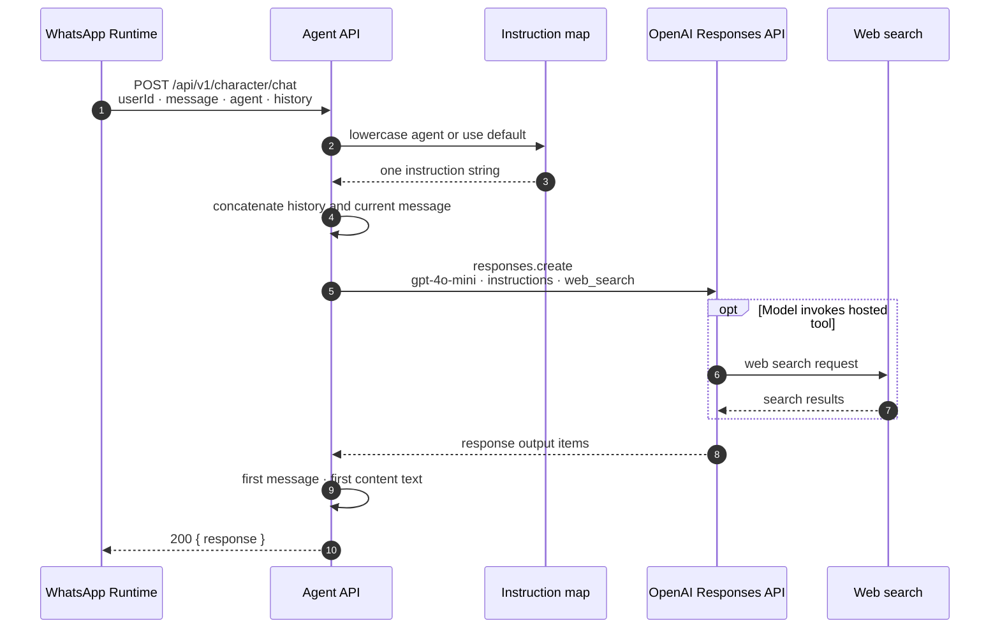
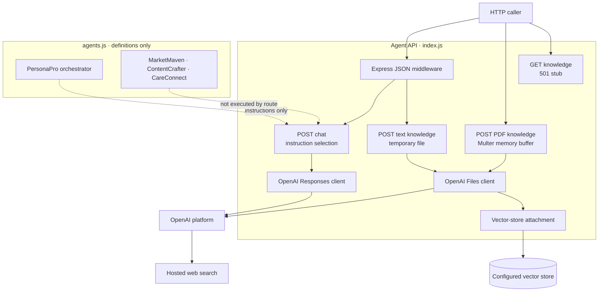

# Component: Agent API

The HTTP and model-provider boundary. One Express entry point accepts
chat and knowledge requests, selects a persona prompt, calls OpenAI,
and exposes the result to the WhatsApp Runtime. It does not execute the
multi-agent graph declared alongside it. See
[02-containers.md](../02-containers.md).

## Runtime

Node.js ESM (`"type": "module"`) on Express 5. `index.js` is the single
HTTP entry point. The package's `npm start` command runs it under
`nodemon`; there is no separate production start script. The process
listens on `process.env.PORT`, defaulting to `3001`.

`express.json()` is the only global middleware in the pinned entry
point. Multer's default in-memory storage is used only on the PDF route.
The code does not configure CORS middleware, HTTP authentication,
request logging, or a global error handler.

`vercel.json` declares an `@vercel/node` build for `index.js` and sends
every incoming path to that file. The repository therefore describes
both a listening Express process and a Vercel routing shape. Which
deployment path is active, and its settings, are **unknown** from the
pinned repositories.

## Configuration

| Variable | Read by | Observed use |
| --- | --- | --- |
| `PORT` | `index.js` | Express listener; defaults to `3001` |
| `OPENAI_API_KEY` | `create_vector_store.js` | Passed explicitly by the standalone helper; the HTTP entry point constructs its client without an explicit key |
| `VECTOR_STORE_ID` | Both knowledge POST routes | Destination vector store for every uploaded file |
| `SUPABASE_URL` | `db.js` | Used only if the otherwise-unreferenced module is loaded |
| `SUPABASE_ANON_KEY` | `db.js` | Used only if the otherwise-unreferenced module is loaded |

There is no example environment file or application-owned schema for
these values. How the HTTP runtime resolves its OpenAI credential is
not specified by the application source. `db.js` validates both
Supabase values at module load, but the HTTP entry point does not import
`db.js`. The Agent API has no observed Supabase operation.

## `POST /api/v1/character/chat`

Generates one model response.

**Request** - JSON fields `userId`, `message`, `agent`, and `history`.
The route destructures all four but uses `userId` for nothing. It does
not validate required fields, types, history entries, roles, or content
length.

**Agent selection** - `(agent || "personapro_ai").toLowerCase()` selects
one of four instruction strings. The recognized case-insensitive keys
are `personapro_ai`, `marketmaven`, `contentcrafter`, and `careconnect`.
An unknown string falls back to PersonaPro. A truthy non-string reaches
`.toLowerCase()`, throws, and is handled as an internal error.

**Input assembly** - when `history` is a non-empty array, the route
concatenates `{ role: "user", content: message }`; otherwise it passes
`message` directly. It does not bound or normalize forwarded history.
The WhatsApp Runtime stores and retrieves the latest message before
calling this route, so that caller supplies the same latest message in
both `history` and `message`.

**Provider call** - `client.responses.create` receives:

```javascript
{
  model: "gpt-4o-mini",
  input: openaiInput,
  instructions,
  tools: [{ type: "web_search" }],
}
```

The Responses API may therefore use OpenAI's hosted web-search tool.
No `file_search`, vector-store identifier, or knowledge metadata is
passed by the chat route.

**Response** - the route finds the first output item whose type is
`message`, then reads `content[0].text`. It returns `{ response }`; if
that extraction yields no text, the response contains a fixed fallback
sentence. It does not expose citations or other output items through
its own response shape.

## `POST /api/v1/character/add-knowledge/text`

Accepts a JSON body with `userId`, optional `title`, and `text`.
Truthy `userId` and `text` are the only checks; missing either returns
`400` with an error object.

The route derives a relative `tmp_<timestamp>.txt` name, writes the
submitted text synchronously, uploads a read stream to OpenAI Files
with purpose `assistants`, and adds caller-supplied metadata:
`user_id`, optional `title`, and type `text`. It then removes the local
file and attaches the OpenAI file ID to `VECTOR_STORE_ID`. Success
returns `{ success: true, file_id }`.

There is a runtime gap in this path: `index.js` is ESM but invokes
`require("fs")` inside the handler without defining `require`. Under
standard Node.js ESM semantics, that identifier is unavailable. No
test or compatibility wrapper in the pinned source establishes another
runtime behavior.

Cleanup is also success-path-specific. If local writing succeeds but
the file upload rejects, the unlink statement is never reached. The
application has no startup or request-time validation for
`VECTOR_STORE_ID` before passing it to the SDK.

## `POST /api/v1/character/add-knowledge/pdf`

Multer's `upload.single("file")` reads one multipart file into memory.
The handler requires truthy `userId` and `req.file`; missing either
returns `400`. `title` is optional.

The buffer and original filename are sent to OpenAI Files with purpose
`assistants`. Metadata contains `user_id`, a title falling back to the
original filename, and type `pdf`. The file ID is then attached to the
same `VECTOR_STORE_ID` used by text ingestion, and success returns
`{ success: true, file_id }`.

This route does not configure a Multer size limit and does not validate
the uploaded MIME type, filename extension, or content. The WhatsApp
caller performs an exact MIME check, but the API is a directly reachable
HTTP boundary and does not enforce that caller behavior itself. Multer
middleware errors occur before the route handler's `try` block; no
application error middleware defines their public response shape.

## `GET /api/v1/character/knowledge`

Always returns status `501` and an error object explaining that the
knowledge base is in an OpenAI vector store. It does not inspect the
caller, list files, query OpenAI, or apply a user filter.

The route's presence is a declared interface, not evidence that
knowledge retrieval is implemented. The actual request and response
shapes for all four routes are summarized by the repository's contract
documentation when present; observed behavior takes precedence over an
aspirational schema.

## Agent Definitions and Runtime Selection

`agents.js` defines four `@openai/agents` objects: a PersonaPro
orchestrator plus MarketMaven, ContentCrafter, and CareConnect
specialists. The three specialists are exposed to PersonaPro with
`asTool`, and the orchestrator instructions say to delegate work to the
appropriate specialist.

That graph is not the HTTP execution path. `index.js` imports only
`personaProAIOrchestrator`, copies its `instructions`, and declares a
manual instruction map for all four names. It never calls the imported
`run` function, never supplies the orchestrator's agent tools to the
Responses API, and never invokes a specialist Agent object. Even
`defaultAgentInstructions` is assigned and then unused.

The result is a precise documentation/implementation distinction:
multi-agent definitions exist, while HTTP chat behavior in the pinned
entry point is caller-selected prompt substitution followed by one
direct Responses API call.

## Knowledge Boundary

Both ingestion paths attach files to one environment-selected vector
store. `userId` is recorded only as caller-supplied file metadata; no
authentication binds that value to the caller, no authorization filter
is applied, and no per-user store is selected.

The chat path does not connect that vector store to the model request.
Knowledge can therefore be uploaded by the observed API, but no
observed chat path retrieves it. File lifecycle after attachment,
retention, deletion, indexing completion, tenant isolation, and
provider-side access policy are **unknown** from these repositories.
See [05-data-model.md](../05-data-model.md) and
[06-security-model.md](../06-security-model.md).

## Error Handling

| Condition | Observed response |
| --- | --- |
| Missing `userId` or `text` on text upload | `400` error object |
| Missing `userId` or file on PDF upload | `400` error object |
| Throw inside either knowledge handler | `500 { error: "Internal server error" }` |
| Throw inside chat handler | `500 { error: "Internal server error" }` |
| Knowledge listing request | `501` error object |

Caught errors are printed to the process console. There are no distinct
timeouts, retries, provider-error mappings, correlation identifiers,
or structured logs. The handlers may already have created a provider
file before vector-store attachment fails; no compensating delete is
attempted. Authentication, authorization, rate limiting, request size
policy for JSON, and bounded chat history are also absent from the
observed API.

## Chat Sequence



## Structure



The diagram distinguishes definitions from the active request path;
the dashed arrows do not represent runtime delegation. End-to-end
request sequences are in [04-flows.md](../04-flows.md).

## Dependencies

| Package or module | Role |
| --- | --- |
| `express` | HTTP routing and JSON parsing |
| `multer` | In-memory single-file multipart parsing for PDFs |
| `openai` | Responses, Files, and vector-store API client |
| `@openai/agents` | Declares the unused-at-runtime orchestrator and specialist graph |
| `dotenv` | Loads process configuration |
| Node filesystem APIs | Intended temporary text-file lifecycle |

`@supabase/supabase-js` is imported only by `db.js`, which is not
connected to the entry point. `axios`, `node-fetch`, `pdf-parse`,
`postgres`, `whatsapp-web.js`, and `zod` are declared dependencies but
have no active import in `index.js`; `zod` is imported but unused in
`agents.js`. The package declares no working automated test command:
`npm test` intentionally exits with an error.
