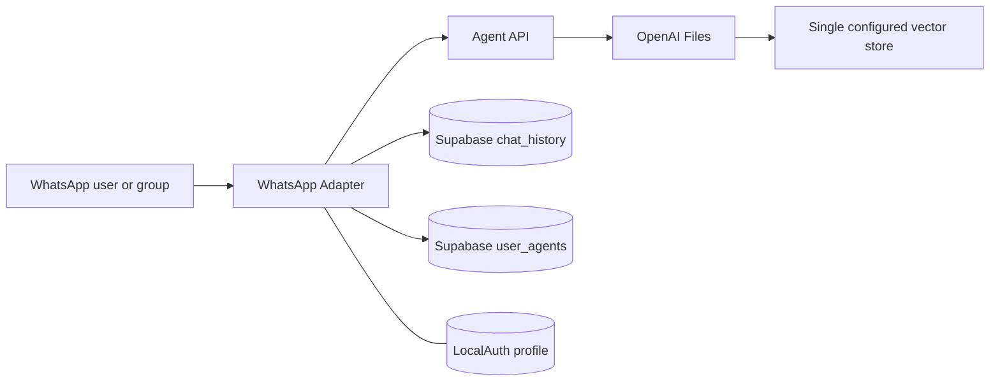

# Component: Data and Knowledge Boundary

This component is not a separate deployable. It names where state lives
today and where the current isolation boundary is known, missing, or
unknown.

## Supabase Tables

Two table names are used by the WhatsApp Adapter:

- `user_agents`
- `chat_history`

No SQL migration, generated type file, RLS policy, index, retention
policy, or backup policy is present in the pinned repositories. The
logical model therefore records unknown field types and constraints
rather than assuming a schema.

## OpenAI Knowledge Objects

Both text and PDF knowledge routes upload files to OpenAI Files, then
attach the uploaded file ID to one vector store identified by
`VECTOR_STORE_ID`. Metadata includes caller-supplied `userId` and a
title, but metadata is not an authorization boundary.

The observed chat route does not enable file search and does not name a
vector store. Uploaded knowledge is therefore persisted but not used by
the observed chat flow.

## WhatsApp LocalAuth

`whatsapp-web.js` LocalAuth stores linked-device session state on disk.
At the pinned WhatsApp commit, LocalAuth/Chromium profile artifacts are
present in the public repository tree and ignore rules for those paths
are commented. This repository does not copy those artifacts.

## Data Flow Diagram

## Lifecycle

| Data | Observed location | Identity boundary | Lifecycle evidence |
| --- | --- | --- | --- |
| Agent selection | Supabase `user_agents` | Adapter-supplied `user_id` | Upserted; no delete path observed |
| Chat messages | Supabase `chat_history` | Adapter-supplied `user_id` | Append-only in code; no retention path observed |
| Knowledge files | OpenAI Files and vector store | Caller-supplied metadata | Created and attached; no list/delete path observed |
| WhatsApp session | LocalAuth Chromium profile | `WHATSAPP_CLIENT_ID` | Persistent local state; cleanup CLI removes local paths |
| Temporary text | Agent API filesystem | Timestamped local file | Deleted only after successful upload path |

## Evidence

| Claim | Source |
| --- | --- |
| `user_agents` upsert | [`whatsapp/index.js` lines 94-108](https://github.com/Elaina-AI-Agents/whatsapp/blob/cd2f34ae6fe09217d47556b4fec18d429847eb85/index.js#L94-L108) |
| `chat_history` insert and select | [`whatsapp/index.js` lines 109-123](https://github.com/Elaina-AI-Agents/whatsapp/blob/cd2f34ae6fe09217d47556b4fec18d429847eb85/index.js#L109-L123) |
| One vector store for text knowledge | [`ai-agents/index.js` lines 15-39](https://github.com/Elaina-AI-Agents/ai-agents/blob/0597bf2ff8e75d09c403f7992a03fe08cba5e0da/index.js#L15-L39) |
| One vector store for PDF knowledge | [`ai-agents/index.js` lines 41-72](https://github.com/Elaina-AI-Agents/ai-agents/blob/0597bf2ff8e75d09c403f7992a03fe08cba5e0da/index.js#L41-L72) |
| Knowledge listing is not implemented | [`ai-agents/index.js` lines 74-78](https://github.com/Elaina-AI-Agents/ai-agents/blob/0597bf2ff8e75d09c403f7992a03fe08cba5e0da/index.js#L74-L78) |
