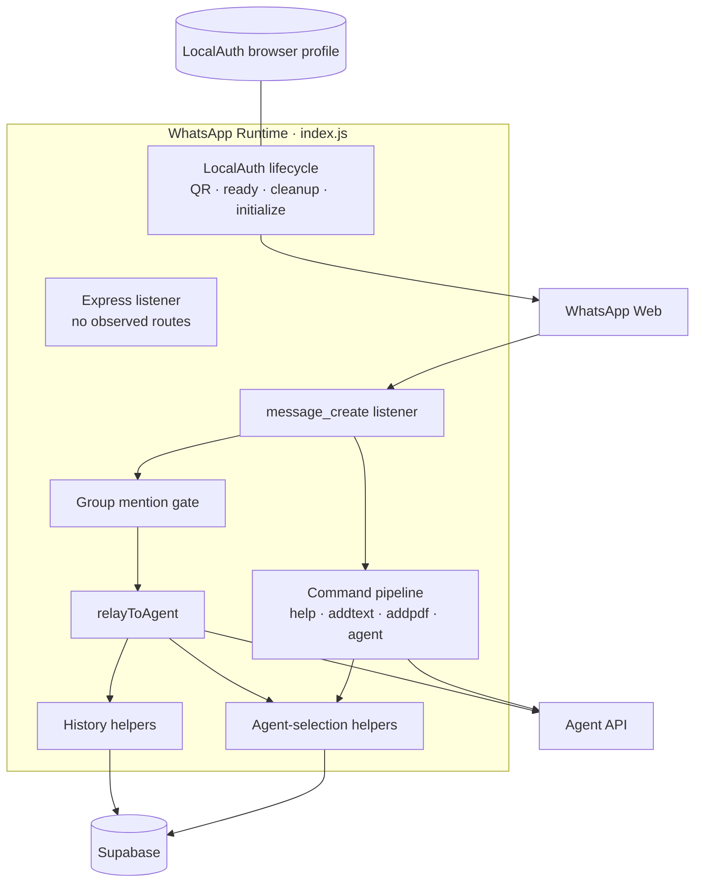

# Component: WhatsApp Runtime

The channel-facing process. A single CommonJS entry point owns the
WhatsApp Web session, command parsing, Supabase-backed conversation
state, and every call to the Agent API. It is the only channel adapter
in the pinned system; no generic channel interface sits in front of it.
See [02-containers.md](../02-containers.md).

## Runtime

Node.js CommonJS (`"type": "commonjs"`) with Express 5 and
`whatsapp-web.js` 1.31. `npm start` runs `node index.js`. The process
listens on `process.env.PORT`, defaulting to `3002`, although the
observed Express application defines no HTTP routes. Its only
middleware is `express.json()`.

The same process also launches the browser automation required by
`whatsapp-web.js`. Puppeteer is transitive through that package rather
than declared directly. Chromium receives `--no-sandbox` and
`--disable-setuid-sandbox`.

There is no startup validation for the environment variables used by
this component. Missing values either select a documented-in-code
default or are passed to the relevant client library; the resulting
library behavior is not established by the pinned application source.

## Configuration

| Variable | Read by | Observed use |
| --- | --- | --- |
| `PORT` | `index.js` | Express listener; defaults to `3002` |
| `WHATSAPP_CLIENT_ID` | `index.js` | LocalAuth profile identity; defaults to `elaina-ai-testnet` |
| `AGENT_API_URL` | `index.js` | Agent API origin; defaults to `http://localhost:3001` |
| `SUPABASE_URL` | `db.js` | Passed to `createClient` |
| `SUPABASE_ANON_KEY` | `db.js` | Passed to `createClient` |

An example environment file, schema, and production secret-loading
mechanism are not present in the pinned source. Their deployed form is
therefore **unknown**.

## LocalAuth Lifecycle

The WhatsApp client is constructed with `LocalAuth`. On first linking,
the `qr` event prints a terminal QR code. Once the client emits
`ready`, the process captures its serialized WhatsApp ID in `botId`;
that value is later used for group mention checks.

LocalAuth persists linked-device browser state. The application also
implements a cleanup-only CLI path:

```text
node index.js --cleanup
```

That path targets `.wwebjs_auth/session-<client id>` beneath the
application directory, removes it recursively with `force: true`, then
exits. Cleanup failures are logged, but the continuation still reports
completion and exits with status zero. Whether this derived cleanup
path always matches the installed LocalAuth library's effective path is
not independently checked by the application.

Initialization is handled separately. An `EBUSY` rejection is reported
as a locked session and recommends the cleanup command; every
initialization rejection exits with status one. No `disconnected`,
reauthentication, or automatic reconnect handler is present in the
pinned entry point.

The pinned public source repository contains LocalAuth/Chromium session
artifacts while the corresponding ignore rules are commented. This
architecture repository records that condition but does not reproduce
session paths below the documented root, identifiers, cookies, tokens,
or session contents. See [06-security-model.md](../06-security-model.md).

## Message and Command Pipeline

One `message_create` listener handles every incoming event. Messages
created by the bot itself return immediately; all other bodies are
trimmed when they are strings. The handler uses `message.from` as
`waNumber`, and classifies any identifier ending in `@g.us` as a group.

Checks occur in a fixed order:

1. `#help`
2. `#addtext <title>` followed by a newline and body text
3. `#addpdf <title>` followed by a newline and body text, with media
4. `#agent <name>`
5. selected-agent lookup
6. group mention gate
7. ordinary chat relay

Because command handling precedes the general group mention gate,
knowledge and agent-selection commands are not protected by that gate.
An exact `#help` also succeeds before the gate; the alternate group
form accepts a message containing `#help` when the bot is mentioned.

The hard-coded choices are `PersonaPro_AI`, `MarketMaven`,
`ContentCrafter`, and `CareConnect`. A recognized `#agent` command
upserts the choice into `user_agents`; an unknown value returns the
list. Although `userAgentMap` is declared in memory, no observed path
reads or writes it.

The help copy says a PDF can be sent with an optional caption. The
actual handler additionally requires the message body to match the
two-line `#addpdf` expression. It extracts a `title` from that match but
does not send that value: the multipart `title` field is populated only
from `message.caption`, when present. This difference is an observed
source/documentation gap, not an inferred target behavior.

## Supabase Helpers

Four small functions inside `index.js` form the persistence boundary.

| Helper | Operation |
| --- | --- |
| `setUserAgent` | Upsert `{ user_id, agent }` into `user_agents`, conflicting on `user_id` |
| `getUserAgent` | Select one `agent` where `user_id` matches |
| `addChatHistory` | Insert `{ user_id, role, content }` into `chat_history` |
| `getChatHistory` | Select all `role, content` rows for the identity, ordered by ascending `id` |

`db.js` constructs one Supabase client from `SUPABASE_URL` and
`SUPABASE_ANON_KEY`. The helpers destructure or ignore `data` but do not
inspect Supabase `error` values. Table types, constraints beyond the
client-side conflict key, indexes, row-level security, retention, and
backup policy are absent from the pinned repositories and remain
**unknown**. The logical shape is documented in
[05-data-model.md](../05-data-model.md).

## Relay Behaviour

Text knowledge is sent as JSON to
`POST /api/v1/character/add-knowledge/text`. PDF knowledge is
downloaded, restricted by this adapter to the exact MIME type
`application/pdf`, decoded from base64 into a buffer, and sent as
multipart form data to `POST /api/v1/character/add-knowledge/pdf`.

Ordinary chat uses `relayToAgent`. It reads the selected agent again,
falling back to `PersonaPro_AI`, writes the current user message, reads
the complete ordered history, and posts the following shape to
`POST /api/v1/character/chat`:

```javascript
{
  userId: waNumber,
  message: body,
  agent,
  history,
}
```

The history read already contains the newly inserted user message. The
Agent API then appends `message` again when `history` is non-empty, so a
normal adapter-originated request presents the latest user input twice
to the model. This is the observed composition of the two pinned
components.

On success, the adapter appends a `#help` footer to string responses,
sends the result to WhatsApp, and persists that augmented result as the
assistant history row. There is also a separate `handleChat` function
that constructs a localized sender-prefixed message and omits history
and agent selection, but no path calls it in the pinned source.

## Group and Private Conversations

Private messages pass directly to relay after an agent exists. Group
messages reach ordinary relay only when `mentionedIds` contains
`botId`.

In both modes, identity is `message.from`. For a private chat this is
the remote chat identity; for a group it is the group JID. Agent choice
and history are consequently shared at group scope rather than scoped
to the participant who sent the message. The handler does not use a
participant identifier to partition those records.

## Error Handling

| Condition | Observed behavior |
| --- | --- |
| Agent API chat request rejects | Sends a fixed failure reply; the already-stored user row remains |
| Text knowledge request rejects | Sends a fixed text-upload failure reply |
| PDF API request rejects | Sends a fixed PDF-upload failure reply |
| Client initialization rejects with `EBUSY` | Logs locked-session guidance and exits `1` |
| Other client initialization rejection | Logs the error and exits `1` |
| Cleanup throws | Logs the error, then cleanup mode exits `0` |

Several operations sit outside local `try` blocks: Supabase calls made
before chat relay, the PDF media download, and command-time agent
selection. The outer event listener does not install a catch. Most
`client.sendMessage` calls are also not awaited, so their delivery
failure behavior is not controlled here. Detailed logs, retry policy,
dead-letter handling, and delivery guarantees are **unknown** because
none is implemented or described in the pinned source.

## Structure



The boxes inside the subgraph are responsibilities in one source file,
not separately deployed services. End-to-end message sequences are in
[04-flows.md](../04-flows.md).

## Dependencies

| Package or module | Role |
| --- | --- |
| `whatsapp-web.js` | WhatsApp client, events, LocalAuth, and transitive browser automation |
| `qrcode-terminal` | Renders the linking QR code in the terminal |
| `express` | Starts the JSON-enabled listener on the runtime port |
| `axios` | Calls all three used Agent API POST routes |
| `form-data` | Builds PDF multipart requests |
| `@supabase/supabase-js` | Persists selected agents and chat history |
| `dotenv` | Loads process configuration |
| Node `fs`, `path`, `util` | Session cleanup and file-path handling |

`form-data` is imported but is not a direct dependency in the package
manifest; the lockfile contains it through other packages. `openai` is
declared but is not imported by the observed WhatsApp runtime.
Automated tests are also absent: the declared `npm test` script
intentionally exits with an error.
