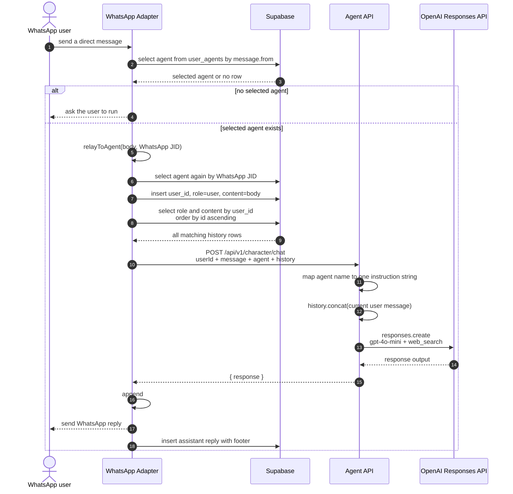
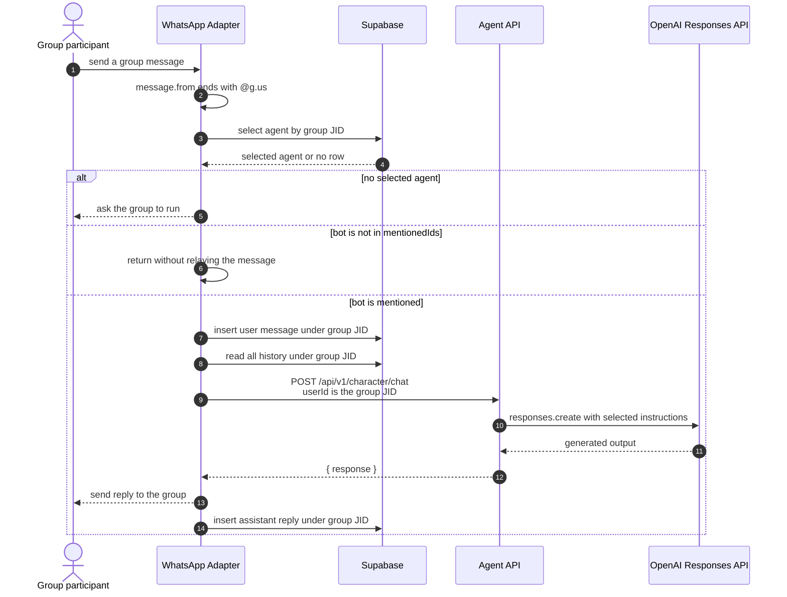
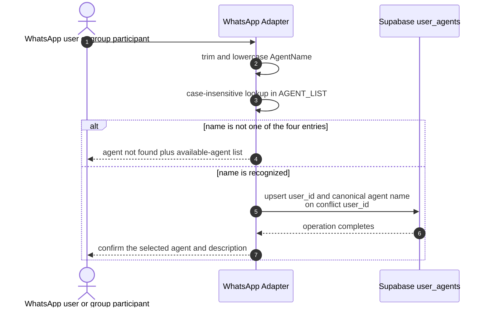
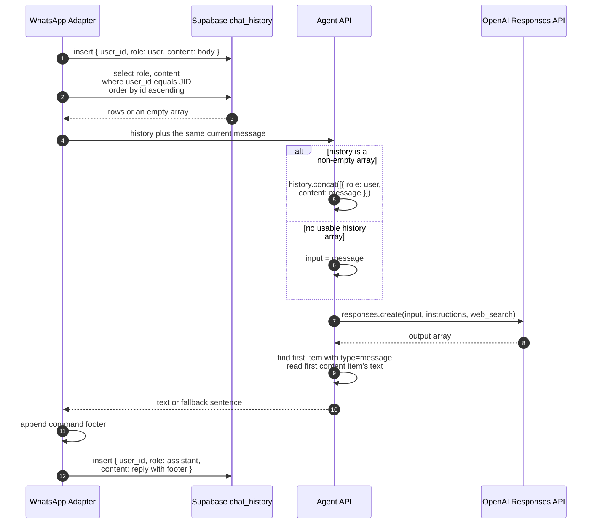
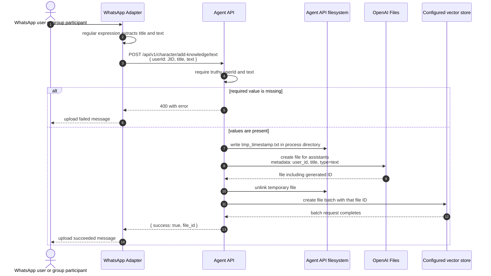
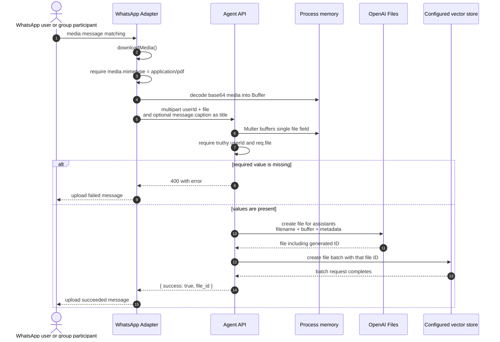

# End-to-End Flows

Six flows cover the implemented user-facing behaviour. Each begins with
what is happening in plain language, then shows the observed sequence in
detail. The diagrams describe the pinned source; they do not add
authentication, retries, queues, validation, or isolation that the
applications do not implement.

---

## 1. Private Chat

A person who has already selected an agent sends the bot a direct
WhatsApp message. The adapter records that message, loads every stored
message for the same WhatsApp JID, and asks the Agent API for a reply.
The reply is sent back through WhatsApp and then recorded in the same
history.

There are two important details in this otherwise synchronous path.
First, the adapter inserts the current user message before reading the
history, so that message is already present in `history`; the Agent API
then concatenates `message` onto that history again. The current content
can therefore reach OpenAI twice. Second, the history query has no
limit, conversation boundary, summary, or retention filter.

The API chooses a static instruction string from the requested agent
name. Although `agents.js` defines an Agents SDK orchestrator and three
sub-agents, this chat endpoint does not run that orchestration graph.
It calls the Responses API directly and enables `web_search`.

---

## 2. Group Mention

Inside a group, ordinary conversation is intended to reach Elaina only
when the bot is mentioned. Agent choice and chat history are keyed by
the group JID, not by the participant who sent the message, so everyone
in that group shares the same selected persona and history stream.

The selected-agent lookup happens before the group mention gate. A
group with no stored agent can therefore receive the selection prompt
even when the incoming message did not mention the bot. Once an agent
exists, an unmentioned ordinary message is ignored after that lookup.

Command handling also precedes the ordinary group gate. Agent selection
and matching knowledge-upload commands are evaluated before the mention
check; `#help` has its own group-specific mention condition. These
ordering details are properties of the current single message handler,
not a general channel-policy layer.

---

## 3. Selecting an Agent

Before normal chat can proceed, a user or group chooses one of four
names compiled into the WhatsApp adapter: `PersonaPro_AI`,
`MarketMaven`, `ContentCrafter`, or `CareConnect`. Selection changes the
instruction string used by later calls; it does not start or bind a
separate agent process.

For a direct message, `user_id` is the sender's WhatsApp JID. For a
group message, it is the group JID. The code awaits the Supabase upsert
but does not inspect the returned error, so the confirmation is not
proof that persistence succeeded.

The source also declares an in-memory `userAgentMap`, described in a
comment as reset-on-restart state, but the implemented selection and
lookup paths do not use it. Supabase is the observed store used by the
runtime flow.

---

## 4. Assembling Chat History and Model Context

History is not a separate request that a user triggers, but it is a
distinct data flow on every accepted chat message. The adapter owns
persistence; the Agent API owns the final transformation into OpenAI
input.

The only fields read back from `chat_history` are `role` and `content`;
`id` is used solely to define ascending order. No code validates stored
roles before forwarding them, checks database errors, bounds the row
count, calculates a token budget, or separates multiple conversations
under the same JID.

Because the command footer becomes part of the persisted assistant
content, it is included in future model context. If the Agent API call
fails, the adapter sends an error message to WhatsApp but does not add
an assistant history row for that failure.

---

## 5. Uploading Text Knowledge

A user supplies a title on the `#addtext` line and text on the following
line or lines. The WhatsApp adapter forwards both to the Agent API,
which turns the text into a temporary file, uploads it to OpenAI Files,
and attaches the resulting file to one configured vector store.

The temporary file is deleted only after the file upload succeeds. It
is not protected by a `finally` block, so a failure before deletion can
leave process-local data behind. The pinned Agent API is declared as an
ES module while this route calls `require("fs")`; that is an observed
runtime compatibility risk rather than a documented success guarantee.

The `user_id` is metadata on the OpenAI file, but every upload is
attached to the same environment-selected `VECTOR_STORE_ID`. The chat
request enables web search only; it does not enable file search or
reference this vector store. Uploading knowledge therefore does not
make it part of the observed chat context.

---

## 6. Uploading PDF Knowledge

PDF upload starts with a WhatsApp media message that also matches the
adapter's `#addpdf` command pattern. The adapter downloads the media,
accepts it when WhatsApp reports `application/pdf`, and sends it to the
Agent API as an in-memory multipart upload.

The help text says a PDF can be sent directly with an optional caption,
but the handler requires both media and a body matching `#addpdf`, with
a title and content separated by a newline. The command-derived title
is not placed in the multipart form; `message.caption`, when present,
is used instead. Otherwise the API falls back to the original filename
for file metadata.

The adapter performs the MIME comparison. The Agent API itself does not
independently validate MIME type, file signature, or upload size, and
Multer is configured without an observed limit. As with text, the file
is attached to the one configured vector store and is not consumed by
the chat path.

---

Next: [05-data-model.md](05-data-model.md) - where the state created by
these flows lives and which parts of its schema remain unknown.
