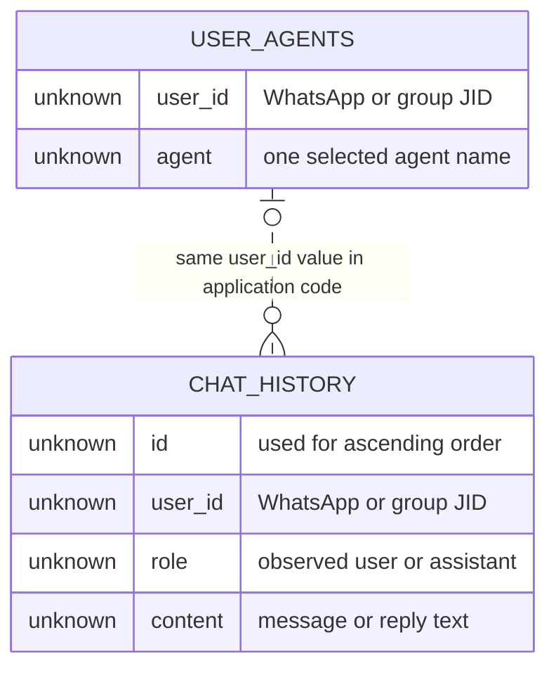

# Data Model

Where Elaina's state lives, what shape can be established from the
pinned source, and what is not stored or cannot be established. The
repositories contain no SQL migrations or generated database types, so
database types, constraints, defaults, indexes, and policies are marked
`unknown` rather than inferred.

## Supabase Data

The WhatsApp adapter reads and writes two table names. Their relationship
is logical only: both carry the same application-supplied `user_id`, but
the source contains no user entity or foreign-key definition.

The dotted relationship is not evidence of a database foreign key. It
shows only that the application uses one JID value to select an agent
and to collect history.

### `user_agents`

| Field | Database type | Observed meaning | Constraint or policy |
| --- | --- | --- | --- |
| `user_id` | `unknown` | Identity key supplied by the WhatsApp adapter | Used as the upsert conflict target; actual uniqueness, nullability, and key definition are `unknown` |
| `agent` | `unknown` | Canonical name chosen from the adapter's four-entry list | Nullability, allowed values, default, and length are `unknown` |

The adapter upserts `{ user_id, agent }`, asks Supabase to resolve a
conflict on `user_id`, and later requests a single matching row. This
expresses the application's expectation of one selection per JID, but
it does not prove that the deployed database has the required unique
constraint. Returned Supabase errors are not inspected.

There is no observed creation timestamp, update timestamp, tenant ID,
channel field, actor ID, or selection history. Whether any such columns
exist in the live table is `unknown`.

### `chat_history`

| Field | Database type | Observed meaning | Constraint or policy |
| --- | --- | --- | --- |
| `id` | `unknown` | Defines the order in which history is returned | Generation, uniqueness, nullability, and index are `unknown` |
| `user_id` | `unknown` | JID used to partition the adapter's queries | Foreign key, index, nullability, and tenant scoping are `unknown` |
| `role` | `unknown` | Written as `user` or `assistant` by the adapter | Check constraint and other accepted values are `unknown` |
| `content` | `unknown` | Incoming message body or outgoing reply text | Encoding, maximum length, nullability, and encryption are `unknown` |

The insert path writes only `user_id`, `role`, and `content`. The read
path selects only `role` and `content`, filters for exact `user_id`, and
orders by `id` ascending. No update or delete operation is present.
That makes the implemented access pattern append-and-read-all, but it
does not establish that the table itself is append-only.

Assistant content includes the `#help` footer appended by the adapter.
The user row is inserted before history is read, so the current message
is included in that read and then concatenated again by the Agent API.

### Supabase Constraints and Policies

The following are all `unknown` because no schema, migration, generated
type, or project policy is present at the pinned commits:

- primary keys and unique constraints;
- foreign keys between either table and any user table;
- column types, defaults, nullability, and maximum lengths;
- indexes beyond whatever may be required by the deployed service;
- Row Level Security enablement and policies;
- grants available to the configured anonymous client role;
- retention, backup, encryption, residency, and deletion policy.

The adapter creates its Supabase client with `SUPABASE_URL` and
`SUPABASE_ANON_KEY`. Those variable names identify configuration inputs;
they do not establish what database policies or privileges are active.

## Identifiers and Conversation Boundaries

`user_id` is not a canonical Elaina user identifier. It is copied from
`message.from`:

- for a direct message, it represents that WhatsApp conversation JID;
- for a group message, it is the group JID identified by the `@g.us`
  suffix check.

The group participant's identity is not persisted separately in the
observed tables. Consequently, one group shares one selected agent and
one history stream. There is also no observed tenant ID, organization
ID, channel ID, conversation ID, thread ID, or mapping from a person
across channels.

`chat_history.id` supplies ordering, but its type and generation rule
are `unknown`. OpenAI supplies a `file.id` for each knowledge upload;
that ID is returned to the adapter, but no pinned application persists
it in Supabase.

## OpenAI-Resident Knowledge Data

Text and PDF uploads create OpenAI File objects with purpose
`assistants`, attach each resulting file ID to the vector store selected
by `VECTOR_STORE_ID`, and return that file ID in the HTTP response.

### File metadata

| Metadata field | Text upload | PDF upload |
| --- | --- | --- |
| `user_id` | Request-body `userId`, supplied from the JID by the adapter | Multipart `userId`, supplied from the JID by the adapter |
| `title` | Request title or `null` | Multipart title or original filename |
| `type` | `text` | `pdf` |

The metadata records a caller-supplied identity label. It is not an
access-control boundary: all observed uploads are added to the same
environment-configured vector store, with no per-user store, namespace,
metadata filter, or authorization check in the source.

The vector store's ID, provider-side schema, region, retention policy,
batch-processing state, and deletion policy are `unknown`. A utility
script can create a store named `ElainaKnowledgeBase`, but the runtime
uses whichever ID is supplied through `VECTOR_STORE_ID`; the pinned
source does not prove that the utility-created store is the deployed
one.

The Agent API's `GET /api/v1/character/knowledge` route returns `501`.
Neither application lists, retrieves, deletes, or searches stored files.
The chat request configures `web_search`, not file search, so vector-store
content is not part of the observed model input.

## Runtime-Resident Data

| Data class | Location | Contents at this level | Observed lifetime |
| --- | --- | --- | --- |
| WhatsApp authentication state | `.wwebjs_auth/session-<client-id>` under the adapter working tree | LocalAuth/Chromium profile artifacts; contents intentionally excluded | Persists across process restarts until removed by the cleanup command or another operator action |
| Bot identity | WhatsApp adapter process memory | Serialized ID assigned when the client becomes ready | Process lifetime |
| Declared `userAgentMap` | WhatsApp adapter process memory | Empty object in the observed implementation; selection paths do not use it | Process lifetime |
| Incoming PDF | Adapter and Agent API memory | Base64-decoded buffer, multipart body, and Multer buffer | Request processing; explicit zeroing is not observed |
| Temporary text file | Agent API working directory | User-provided text in a timestamp-named `.txt` file | Deleted on the successful file-upload path; failure-path lifetime is not bounded |
| Model request and response | Agent API process memory | Instructions, history, message, and OpenAI response | Request processing; explicit retention control is not observed |

The LocalAuth entry describes only the class and location of runtime
state evidenced by code. This architecture repository does not copy or
describe cookies, tokens, QR material, browser databases, session
payloads, or other authentication contents. The pinned WhatsApp source
tree contains LocalAuth/Chromium artifacts; that exposure is handled as
a risk in [06-security-model.md](06-security-model.md), not reproduced
here.

## Data Residency

| Data | Observed system | Identity boundary | Persistence evidence |
| --- | --- | --- | --- |
| Selected agent | Supabase `user_agents` | Exact application-supplied JID | Upserted; no deletion path observed |
| Chat messages and replies | Supabase `chat_history` | Exact application-supplied JID | Inserted and read in full; no retention path observed |
| Knowledge file and metadata | OpenAI Files | Metadata contains caller-supplied JID | Created; no listing or deletion path observed |
| Knowledge association | One configured OpenAI vector store | No enforced per-user boundary observed | File batch created; later processing and retention are `unknown` |
| WhatsApp authentication profile | Operator host filesystem | Configured LocalAuth client ID | Persistent profile with a recursive cleanup command |
| Temporary text | Agent API host filesystem | Timestamp-based process-local filename | Success-path deletion only |
| PDF upload buffers | Adapter and Agent API memory | One inbound message/request | Request lifetime is implied; cleanup details are `unknown` |

Supabase project location, OpenAI data region, the operator host's
location, backups, replicas, encryption configuration, and recovery
objectives are not recorded in the source. Their values are `unknown`.

## What Is Not Stored or Not Evidenced

The pinned applications do not show storage for:

- a canonical user, tenant, actor, or cross-channel identity;
- a separate conversation or thread record;
- group-participant identity alongside group-level history;
- an authenticated API principal, authorization grant, or API session;
- a Supabase record linking an OpenAI file ID to its uploader;
- vector-store search results or knowledge citations in chat history;
- message delivery status, retries, idempotency keys, or a job queue;
- model token usage, web-search usage, latency, or cost records;
- explicit consent, retention deadline, deletion request, or audit log.

The organization profile mentions a `knowledge_files` table, but the
pinned `ai-agents` and `whatsapp` applications do not read or write it.
Its schema and deployed existence are therefore not established by the
implemented runtime.

Absence from these repositories does not prove that operator-managed
platforms retain nothing else. Provider-side logs, backups, telemetry,
and default retention are outside the inspected source and remain
`unknown`.

---

Next: [06-security-model.md](06-security-model.md) - the trust boundaries
and risks created by this data and control flow.
