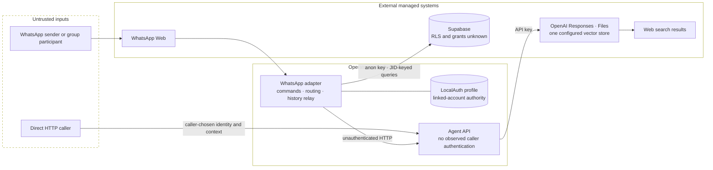

# Security and Trust Model

## How to Read This Document

This document maps the trust boundaries visible in the pinned Elaina
repositories. It distinguishes behavior enforced by application code from
controls that are missing, and both from controls whose status is unknown
because their configuration is not present in source.

It is descriptive, not a production-security claim. It contains no credential,
cookie, QR, session-database, or exploit material. Remediation directions are
summarized below, expanded in the
[security remediation backlog](security-remediation-backlog.md), and developed
as constraints in [08-future-work.md](08-future-work.md).

## Trust Zones

### WhatsApp and the sender

WhatsApp Web is external to the system. `whatsapp-web.js` supplies message and
sender metadata to the adapter, but the application does not establish a
separate authenticated Elaina identity. For direct messages, the WhatsApp JID
is used as `user_id`. For group messages, the group JID is used, so agent
selection and history are shared at the group-conversation boundary rather
than attributed to an individual participant.

Message text, captions, media, display names, mentions, and commands are
untrusted input. The adapter ignores messages marked `fromMe`. Ordinary group
chat reaches the agent only after a bot mention, but command handling occurs
before that mention gate.

### The WhatsApp runtime

Operator-controlled. This long-running Node.js process owns the linked-device
session, starts Chromium, interprets commands, and relays requests to Supabase
and the Agent API. Its LocalAuth profile carries the authority of the linked
WhatsApp account.

Chromium is launched with `--no-sandbox` and `--disable-setuid-sandbox`. The
profile is persistent by design, and a LocalAuth directory is present in the
pinned public source tree while the corresponding ignore rules are commented
out. This document does not inspect or reproduce its contents.

### The Agent API

Operator-controlled code behind an unauthenticated HTTP boundary. The Express
routes accept chat and knowledge requests without authentication,
authorization, rate limiting, or a verified service identity. A direct caller
does not need to pass through WhatsApp and may choose request fields such as
`userId`, `agent`, `history`, and knowledge metadata.

The API selects a static instruction string and calls the OpenAI Responses API.
The specialist `Agent` objects defined in `agents.js` do not participate in
this request path.

### Managed data and AI services

Supabase and OpenAI are external managed systems. The WhatsApp runtime reaches
Supabase with an anon key. Row Level Security policies, grants, migrations, and
table constraints are not present in the pinned repositories, so database-side
isolation is unknown.

The Agent API reaches OpenAI with an API key and attaches every uploaded file
to one environment-configured vector store. Caller-supplied `user_id` metadata
records a label; it does not establish an authorization boundary. Chat enables
web search, but it does not enable file search, so uploaded knowledge is not
used by the observed chat path.

## What the Source Does Guarantee

The pinned application code enforces a small set of routing rules:

- messages marked `fromMe` are ignored;
- the agent-selection command accepts only one of four hard-coded names;
- ordinary group chat requires the bot to be mentioned;
- text ingestion requires truthy `userId` and `text` fields;
- PDF ingestion requires truthy `userId` and a multipart file;
- the WhatsApp adapter checks the downloaded media MIME value before relaying
  a PDF command; and
- unknown agent values sent to the chat API fall back to PersonaPro
  instructions.

These are application checks, not cryptographic identity guarantees. In
particular, the HTTP API does not prove that `userId` came from WhatsApp, that a
caller is permitted to use an agent or vector store, or that supplied history
belongs to the same actor or conversation.

## What Is Not Guaranteed

The pinned source does not guarantee:

- authentication or authorization on any Agent API route;
- separation between an individual group participant and the group JID;
- per-user or per-tenant knowledge isolation;
- database isolation, because Supabase policy artifacts are absent;
- application-owned limits for upload size, context length, retention, or
  request frequency;
- idempotent processing or replay protection;
- retrieval of uploaded knowledge during chat;
- Chromium host isolation while its sandbox is disabled;
- secure custody of the committed LocalAuth profile; or
- production monitoring, audit attribution, backup, or recovery behavior.

An absent repository artifact does not prove that an external deployment lacks
the control. Such cases are labeled **unknown** rather than **missing** below.

## Access-Control Inventory

| Operation | Who can reach it in observed code | Application check | Security boundary |
| --- | --- | --- | --- |
| Link the WhatsApp client | A person with access to the runtime console and QR flow | LocalAuth and WhatsApp Web linking | Operator/runtime access; deployment controls unknown |
| `#help` | Any non-self sender; an exact command is accepted in direct or group chat | Command pattern | No Elaina identity or role check |
| `#agent <name>` | Any non-self sender, including a group participant without mentioning the bot | Name must match the hard-coded list | Selection is stored under the direct or group JID |
| `#addtext` | Any non-self sender matching the command pattern | Title/body pattern in adapter; truthy `userId` and `text` in API | No service authentication or ownership check |
| `#addpdf` | Any non-self sender with media and the required command body | Adapter checks `application/pdf`; API checks only that a file exists | No API-side type, size, or ownership check |
| Ordinary direct chat | Any non-self direct sender after an agent is selected | Selected agent must exist for that JID | WhatsApp JID is trusted as the data key |
| Ordinary group chat | Any group participant after a group-level agent is selected | Bot mention required for the ordinary chat path | Group JID, not participant identity, is the data key |
| `POST /api/v1/character/chat` | Any network caller that can reach the API | No required-field validation; agent fallback only | No authentication or authorization observed |
| Knowledge POST routes | Any network caller that can reach the API | Presence checks only | Caller-chosen `userId`; one vector store |
| `GET /api/v1/character/knowledge` | Any network caller that can reach the API | Always returns `501` | No data is listed by this route |
| Supabase table operations | The WhatsApp process using its configured anon key | Query predicates use caller-derived JIDs | RLS and grants unknown |

## Identity and Isolation

Identity changes meaning as a request crosses the system. WhatsApp provides a
JID; the adapter serializes that value as `userId`; the Agent API accepts it as
ordinary request data. There is no signed service assertion binding these
representations together.

In a direct chat, that key represents the remote WhatsApp account. In a group,
it represents the group itself. All participants therefore share the selected
agent and chat-history partition. The message's individual participant is not
stored as a separate actor identifier.

Knowledge uses a still weaker boundary. Both ingestion routes accept a
caller-supplied `userId` and place the resulting OpenAI file in the same
`VECTOR_STORE_ID`. Metadata is useful for description but is not enforcement.
Because the observed chat route does not perform file retrieval, cross-user
retrieval is not an active chat behavior in this snapshot; it becomes a direct
confidentiality risk if retrieval is added without an ownership check.

## Replay, Duplication, and Context Integrity

No message ID, idempotency key, request nonce, or processed-event ledger is
recorded. A redelivered message or repeated HTTP request can append history,
upload another file, attach it again, and consume provider budget more than
once.

For chat, the adapter stores the current user message and then reads the entire
conversation in ascending order. The API appends the same current message to
the supplied history before calling OpenAI. The current input is therefore
represented twice in the observed relay path. There is no maximum row count,
token budget, role schema validation, summarization boundary, or retention
policy.

The history array is also accepted directly from any API caller. Its origin and
conversation ownership are not verified. Model instructions provide behavioral
guidance, but they do not make message content, stored history, or web results
trusted input and do not constitute an authorization mechanism.

## Resource and Availability Risks

Multer is configured with in-memory storage and no observed file-size limit.
Text ingestion writes the entire supplied value to a process-local temporary
file. The temporary text file is removed on the successful path, but cleanup is
not in a `finally` block. Chat context, multipart uploads, concurrent requests,
provider calls, and web-search usage have no application-configured bounds or
timeouts. Express library defaults may bound JSON parsing, but the application
does not declare that behavior as a contract or cost budget.

These properties let any caller who can reach the API consume memory, storage,
model, search, and vector-store budget. They also make latency and cost grow
with conversation history.

The Supabase helpers destructure returned `data` but do not inspect returned
errors. A failed selection can therefore become an apparent missing agent or
empty history, while failed inserts and upserts receive no application-level
handling. This is an integrity and diagnosability risk; the database's actual
availability and policy behavior remain external and unknown.

## Secret and Session Custody

| Sensitive material | Held by | Reaches another boundary | Source status |
| --- | --- | --- | --- |
| WhatsApp linked-device session | LocalAuth/Chromium profile on the WhatsApp host | Used with WhatsApp Web | A profile directory is tracked in the pinned tree; contents are intentionally excluded here |
| `SUPABASE_ANON_KEY` | WhatsApp process environment | Supabase | Read without startup validation; value not committed in the inspected application files |
| `OPENAI_API_KEY` | Agent API process environment | OpenAI SDK | Read through SDK defaults; value not reproduced here |
| `VECTOR_STORE_ID` | Agent API process environment | OpenAI vector-store calls | Read without startup validation |
| QR linking data | Runtime console during linking | Human operator and WhatsApp | Ephemeral handling policy unknown |

The WhatsApp cleanup mode recursively deletes the configured LocalAuth session
directory. It is an operator utility, not automatic rotation or revocation.
Repository deletion alone would not prove that an already-linked device or
copied history had been invalidated.

## Network Exposure

The Agent API binds an Express listener and exposes its routes without auth or
rate limiting. The pinned source does not specify its production hostname,
firewall, TLS termination, private-network placement, or CORS policy. The
Vercel manifest routes every path to `index.js`, but the repository does not
prove that a live Vercel deployment exists.

The WhatsApp process also starts an Express listener, but defines no HTTP
routes. Its listener still adds a network surface whose production binding,
firewall, and health-check purpose are unknown.

## Trust-Boundary Diagram

## Severity-Based Remediation Summary

### P0 — contain exposed authority and establish identity

- Revoke and replace any linked-device authority associated with tracked
  LocalAuth material, then remove session/cache artifacts from the repository
  and coordinated history.
- Authenticate Agent API callers and authorize every operation from a verified
  identity; never treat request-body `userId` as proof.
- Establish tenant-scoped knowledge ownership before enabling retrieval,
  listing, or deletion.

### P1 — bound production risk

- Version Supabase migrations, constraints, grants, and RLS policies, and prove
  cross-identity isolation with tests.
- Add schema, MIME/signature, size, context, concurrency, timeout, quota, and
  rate-limit controls at system boundaries.
- Restore an appropriate Chromium sandbox or isolate the browser workload in a
  hardened runtime.
- Define retention, deletion, backup, and recovery behavior for messages,
  knowledge, and session state.

### P2 — make controls operable

- Add correlation IDs, structured redacted logs, health checks, metrics,
  alerts, and audit ownership.
- Add unit, integration, authorization, isolation, and critical-flow tests to a
  reviewed delivery pipeline.
- Reconcile public capability claims with released behavior and maintain
  incident runbooks for session compromise, provider failure, and runaway cost.

This architecture repository documents those outcomes only. Remediation must be
implemented and independently verified in the source systems.
