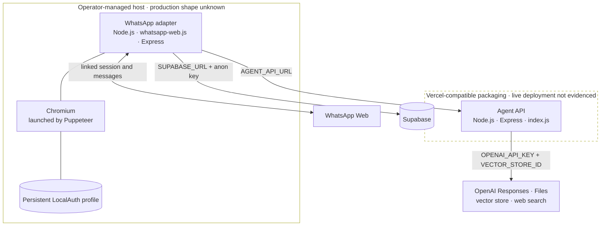

# Deployment

## Observed Topology

The pinned repositories describe two Node.js processes and three external
platforms. Only the Agent API contains a deployment manifest. The topology below
therefore separates source-described packaging from a confirmed live
deployment.



The Agent API defaults to port `3001`. The WhatsApp adapter defaults to port
`3002`, starts an Express listener, and defines no HTTP routes. The source does
not record public URLs, regions, TLS termination, firewall rules, private
networking, environment separation, process supervision, or service-level
objectives.

## Runtime and Build Details

### Agent API

`package.json` declares an ES module package and `index.js` as its entry point.
The `start` script runs `nodemon index.js`; `nodemon` is included as a regular
dependency. No production-only start command is declared.

There is no compile or bundle step in the package scripts. Express starts at
module load, initializes the OpenAI client from its default environment lookup,
and listens on `PORT || 3001`.

The text-ingestion handler calls CommonJS `require("fs")` from an ES module.
`require` is not defined by standard Node.js ES-module execution, so that path
contains a source/runtime mismatch unless the deployment environment supplies a
non-standard transform or global. No such transform is declared in the
repository.

### WhatsApp adapter

`package.json` declares CommonJS and starts the process with `node index.js`.
The process initializes `whatsapp-web.js`, launches Chromium with its sandbox
disabled, persists LocalAuth state, registers message listeners, and starts an
Express listener on `PORT || 3002`.

This is a long-running, stateful workload. It must retain filesystem access to
the LocalAuth profile and maintain a Chromium session after QR linking. The code
exits on initialization failure and reports a locked-session case, but the
repository supplies no supervisor, container, health route, readiness probe, or
restart policy. A stateless request platform would not preserve this runtime
contract without additional state and process design.

### Node.js and dependency installation

Both repositories include `package-lock.json`, so `npm install` or `npm ci` can
resolve the recorded dependency graph. Neither package declares a Node.js
`engines` range, `.nvmrc`, container image, or other runtime version pin. The
exact Node.js and Chromium versions used in production are unknown.

Both package `test` scripts print `Error: no test specified` and exit with a
failure status. No application CI or build validation is present in the pinned
source repositories.

## Vercel Manifest

The Agent API's `vercel.json` declares version 2, builds `index.js` with
`@vercel/node`, and routes every path matching `/(.*)` to that file:

```json
{
  "version": 2,
  "builds": [{ "src": "index.js", "use": "@vercel/node" }],
  "routes": [{ "src": "/(.*)", "dest": "/index.js" }]
}
```

This is evidence of Vercel-compatible intent, not evidence of a deployed Vercel
project. The module also calls `app.listen` unconditionally rather than exporting
the Express application or a handler. Whether the pinned source operates as
intended under the selected Vercel runtime is not demonstrated by tests,
workflow results, or deployment metadata in the repository.

The WhatsApp repository has no Vercel manifest or other production deployment
artifact.

## Environment Configuration

### Agent API

| Variable | Configures | Default | Validated at startup |
| --- | --- | --- | --- |
| `PORT` | Express listening port | `3001` | No; a truthy value is passed to `listen` |
| `OPENAI_API_KEY` | OpenAI SDK authentication | None observed | No explicit application validation; SDK behavior applies |
| `VECTOR_STORE_ID` | Destination for all knowledge uploads | None | No |

`dotenv.config()` loads a local environment file when present. The repository
contains no `.env.example`, schema, or startup assertion. Missing provider
configuration is therefore discovered when initialization or a provider call
fails, not through an application-owned readiness check.

### WhatsApp adapter

| Variable | Configures | Default | Validated at startup |
| --- | --- | --- | --- |
| `PORT` | Express listening port | `3002` | No; a truthy value is passed to `listen` |
| `WHATSAPP_CLIENT_ID` | LocalAuth profile identifier | `elaina-ai-testnet` | No |
| `AGENT_API_URL` | Agent API base URL | `http://localhost:3001` | No |
| `SUPABASE_URL` | Supabase project URL | None | No application-owned validation |
| `SUPABASE_ANON_KEY` | Supabase client credential | None | No application-owned validation |

The Supabase client is created when `db.js` is loaded. Application helpers do
not inspect returned Supabase errors, and no health check confirms database
connectivity before the bot reports WhatsApp readiness.

Environment values are intentionally omitted from this public documentation.

## Starting Locally

### Agent API

```bash
npm install
npm start
```

As committed, `npm start` invokes `nodemon index.js` and listens on port `3001`
unless `PORT` is set. Chat requires OpenAI credentials. Knowledge ingestion also
requires a vector-store identifier.

### WhatsApp adapter

```bash
npm install
npm start
```

The default `AGENT_API_URL` expects the Agent API at
`http://localhost:3001`. On first use, the process prints a QR code to the
terminal. After linking, LocalAuth persists the browser profile below the
repository working directory.

The source also exposes an operator cleanup mode:

```bash
node index.js --cleanup
```

It recursively deletes the session directory selected by
`WHATSAPP_CLIENT_ID` and exits. This is destructive local cleanup; it is not a
substitute for revoking a linked device when session authority may have been
exposed.

## Data and State Placement

| State | Observed placement | Deployment consequence |
| --- | --- | --- |
| Agent selection | Supabase `user_agents` | Database schema, constraints, and RLS must already exist; their deployment is not in source |
| Chat history | Supabase `chat_history` | Retention and growth are external to the app and unspecified |
| Uploaded files | OpenAI Files plus one configured vector store | Store provisioning is an operator prerequisite; a helper script exists but release use is not documented |
| Temporary text knowledge | Agent API working directory | Requires writable process-local storage; cleanup is only on the successful path |
| WhatsApp session and Chromium cache | WhatsApp host filesystem | Requires persistent, private storage and single-writer coordination |

The organization profile mentions a `knowledge_files` table and SQL in the
repository, but neither pinned application uses that table and no SQL migration
is present. Deployment cannot reproduce the database contract from these
repositories alone.

## Source and Profile Mismatches

The organization profile is useful as stated intent, but several deployment and
runtime details differ from the pinned application source:

1. **Model.** The profile names GPT-4o; the chat route hard-codes
   `gpt-4o-mini`.
2. **Knowledge retrieval.** The profile describes vector-store retrieval and
   per-user knowledge. The runtime uploads to one vector store, enables only web
   search for chat, and has no retrieval authorization path.
3. **Agent orchestration.** Specialist Agent tools are defined, but the HTTP
   chat route selects static instruction text and calls the Responses API
   directly.
4. **PDF command.** The profile and help text say to send a PDF, while the
   handler also requires a body matching the `#addpdf` pattern.
5. **Database setup.** The profile refers to SQL and a `knowledge_files` table;
   no migration is committed and the observed applications do not use that
   table.
6. **Repository layout.** The setup instructions describe `wa-client` and
   `wa-agent` directories in one checkout, while the pinned system is split
   across separate `whatsapp` and `ai-agents` repositories.

## Deployment Unknowns

The pinned repositories do not establish:

- whether either service is currently deployed, and at which immutable release;
- the WhatsApp host, Vercel project, region, hostname, or network policy;
- Node.js, Chromium, or operating-system versions;
- process supervision, horizontal-scaling behavior, or single-session locking;
- secret storage, rotation, environment promotion, and operator access policy;
- database migrations, RLS, backups, restore testing, or connection limits;
- OpenAI vector-store provisioning and lifecycle ownership;
- TLS termination, request-body limits outside Express, or upstream timeouts;
- log retention and redaction, monitoring, alerting, incident response, or SLOs;
- release, rollback, and disaster-recovery procedures.

These are unknown because no evidence is present in the pinned repositories.
They must not be inferred from the source-level topology.
