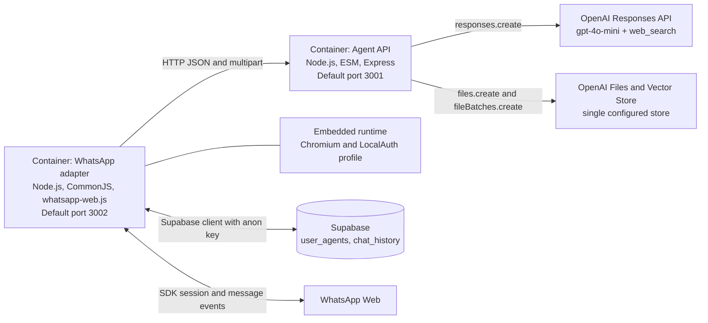
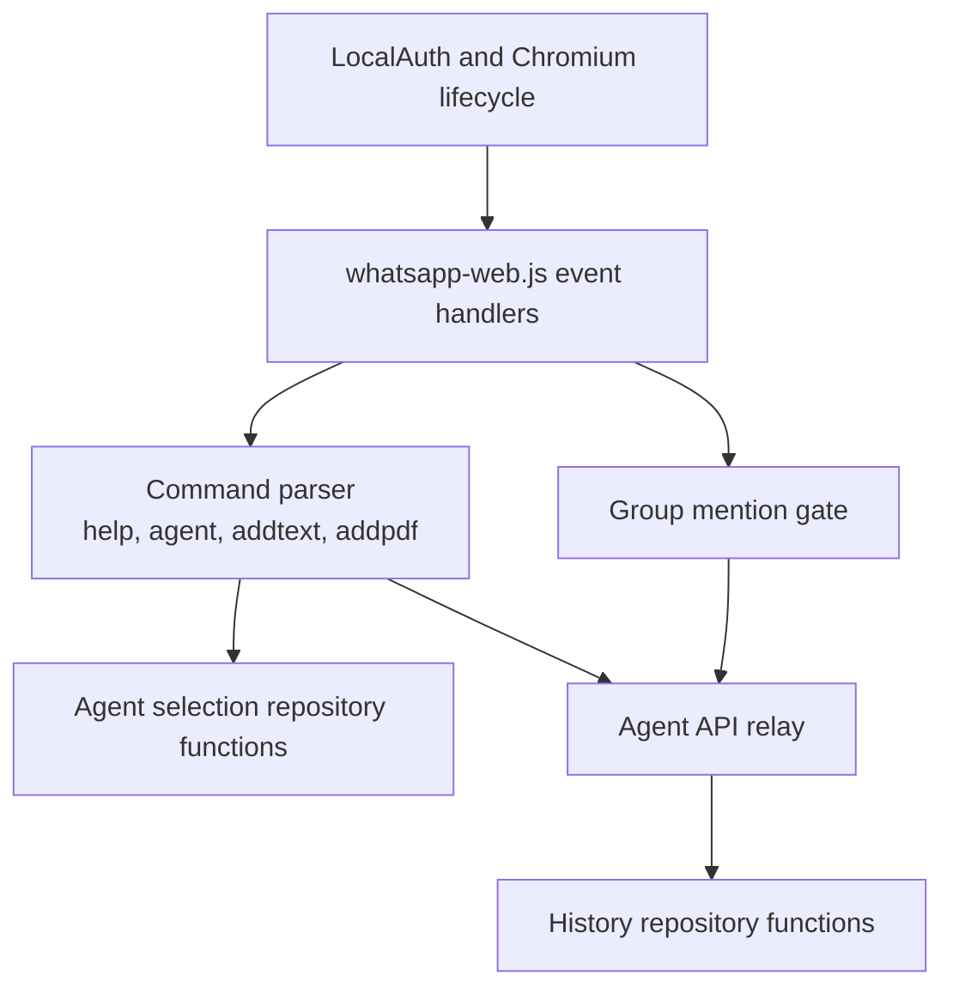
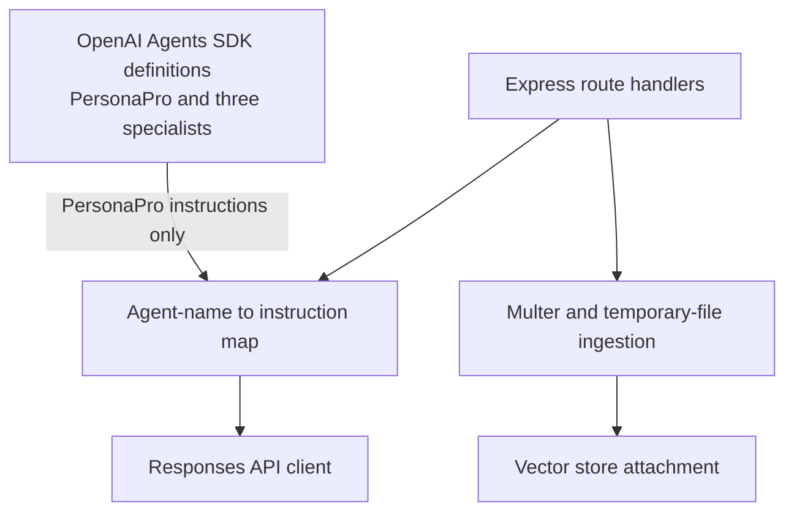

# Containers and components

## Container view

The Agent API has a Vercel routing manifest. No deployment manifest is observed for the stateful, long-running WhatsApp adapter.

## WhatsApp adapter components

All components are functions and handlers in one `index.js`; the diagram separates responsibilities, not files or independently deployable units. An unused in-memory `userAgentMap` is declared, while persisted selection uses Supabase.

## Agent API components

The specialist Agents SDK tools are defined but are not executed by the HTTP chat route. The route selects a static instruction string and calls the Responses API directly.
