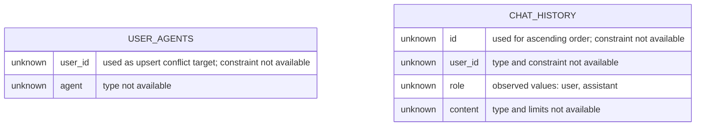
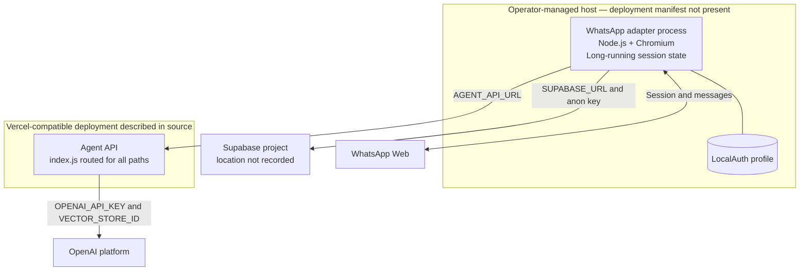

# Data and deployment

## Observed logical data model

No SQL migration, generated database types, constraints, indexes, or Row Level Security policies are present in the pinned repositories. The model below contains only fields referenced by application code.

The two tables share an observed `user_id` value, but no foreign key or separate user entity is evidenced. In direct messages it is a WhatsApp JID; in group messages it is the group JID.

The organization profile mentions `knowledge_files`, but neither pinned application reads or writes that table. Knowledge metadata is sent to OpenAI Files, and every uploaded file is attached to one environment-configured vector store.

## Data ownership and lifecycle

| Data | Observed location | Identity boundary | Lifecycle evidence |
| --- | --- | --- | --- |
| Agent selection | Supabase `user_agents` | `user_id` supplied by adapter | Upserted; no deletion path observed |
| Chat messages | Supabase `chat_history` | `user_id` supplied by adapter | Append-only in code; no retention path observed |
| Knowledge files | OpenAI Files and vector store | Metadata contains caller-supplied `user_id` | Created and attached; no listing or deletion path observed |
| WhatsApp session | LocalAuth Chromium profile | Configured WhatsApp client ID | Local persistent state; cleanup CLI recursively deletes it |
| Temporary text | Agent API filesystem | Timestamped process-local file | Deleted only after a successful OpenAI upload |

## Observed deployment topology

The Agent API defaults to port 3001 and the WhatsApp adapter to port 3002. The adapter starts an Express listener but defines no HTTP routes. Health checks, process supervision, TLS termination, secret storage, environment separation, backups, metrics, logs, and recovery objectives are not specified.

## Environment variables observed

| Container | Variable | Observed purpose |
| --- | --- | --- |
| WhatsApp adapter | `PORT` | Express listener port, default 3002 |
| WhatsApp adapter | `WHATSAPP_CLIENT_ID` | LocalAuth profile identifier |
| WhatsApp adapter | `AGENT_API_URL` | Agent API base URL, default localhost:3001 |
| WhatsApp adapter | `SUPABASE_URL` | Supabase project URL |
| WhatsApp adapter | `SUPABASE_ANON_KEY` | Supabase client credential |
| Agent API | `PORT` | Express listener port, default 3001 |
| Agent API | `OPENAI_API_KEY` | OpenAI SDK authentication through SDK defaults |
| Agent API | `VECTOR_STORE_ID` | Single destination vector store |

The table names variables only. It does not include values or assert that production configuration exists.
