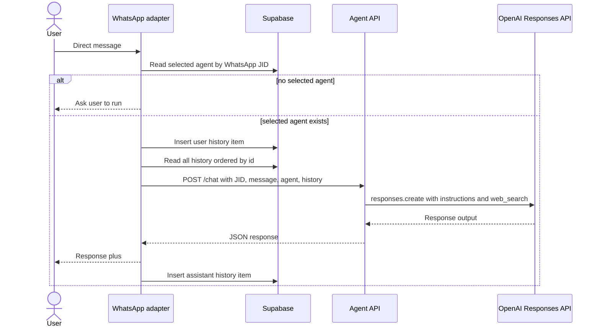
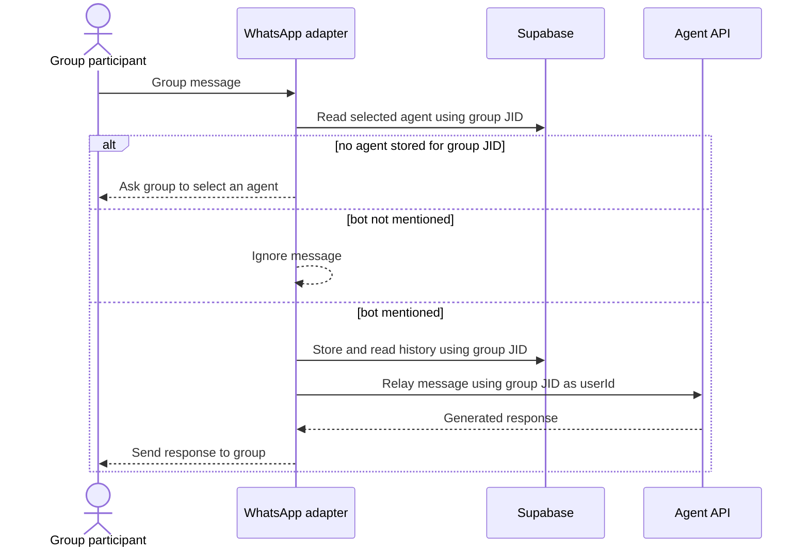
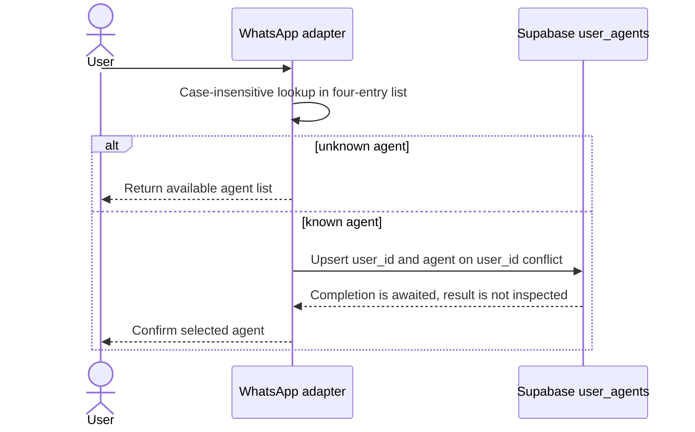
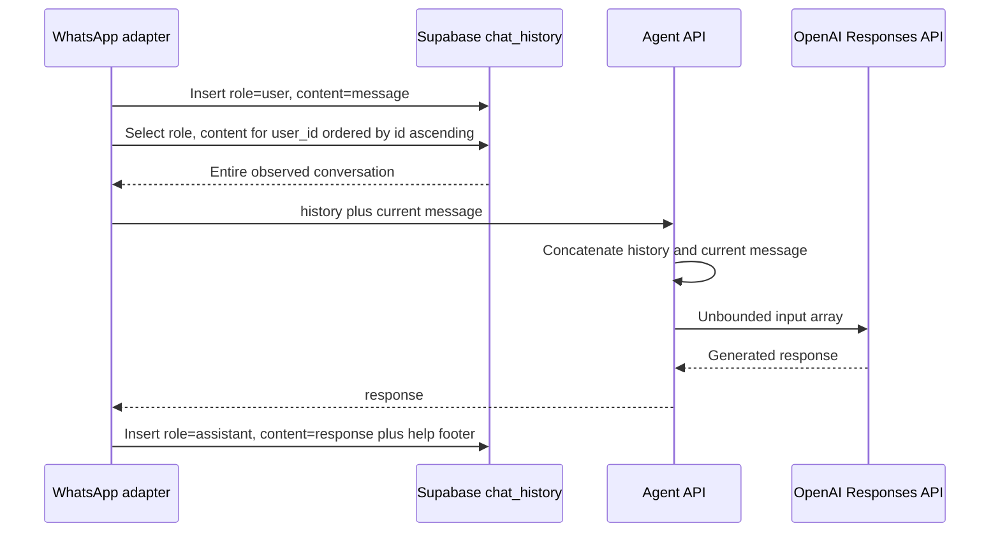
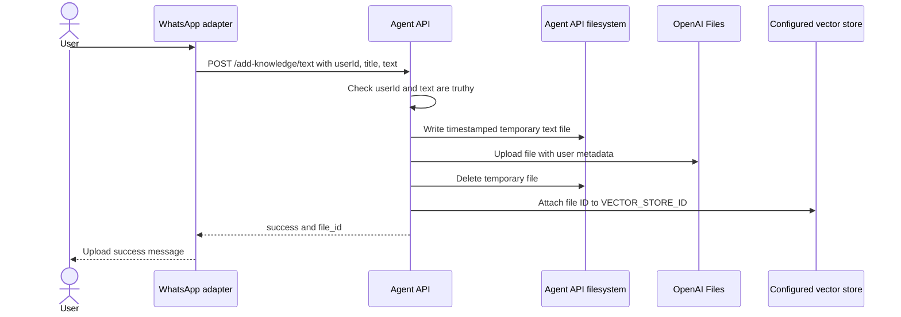
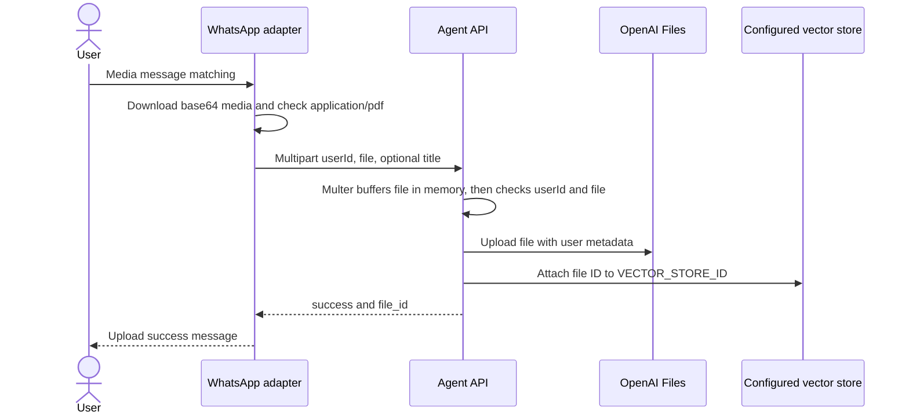

# Runtime flows

These sequences describe observed control flow. They do not add authentication, retries, queues, or validation that the pinned applications do not implement.

## Private chat

The history query is not bounded. The just-inserted user message is included in `history`, and the Agent API appends the current `message` again before calling OpenAI, so the current user content may be duplicated.

## Group mention

The group JID, not the individual sender JID, is used for agent choice and history. The resulting state is shared at group level.

## Agent selection

## Chat history

Database errors are not checked in the helper functions. No retention, pagination, summarization, token budget, or conversation boundary is observed.

## Text knowledge upload

The pinned Agent API is an ES module but calls `require` in this route. That is a runtime compatibility risk. Cleanup also occurs only on the success path.

## PDF knowledge upload

The help text says a PDF can be sent directly, but the handler additionally requires the message body to match the `#addpdf` title-and-body regular expression. The adapter checks the media MIME type; the API does not independently enforce MIME type or size.
