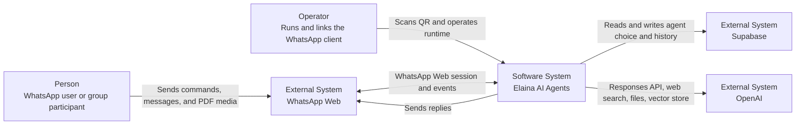

# System context

## Scope

Elaina is observed as a WhatsApp bot that delegates response generation and knowledge ingestion to an HTTP Agent API. Supabase stores selected agents and chat history. OpenAI provides response generation, web search, file storage, and a configured vector store.

## People and responsibilities

| Actor | Observed interaction |
| --- | --- |
| WhatsApp user | Chooses an agent, chats, asks for help, and submits text or PDF knowledge. |
| Group participant | Triggers chat only when the bot is mentioned; commands have separate matching behavior. |
| Operator | Starts the long-running WhatsApp process, completes QR linking, configures environment variables, and handles session-lock recovery. |

## System boundary

The Elaina boundary contains two separately packaged Node.js applications. WhatsApp, Supabase, and OpenAI are external managed systems. No web UI, admin UI, event broker, queue, or separate identity provider is observed in the pinned source.
