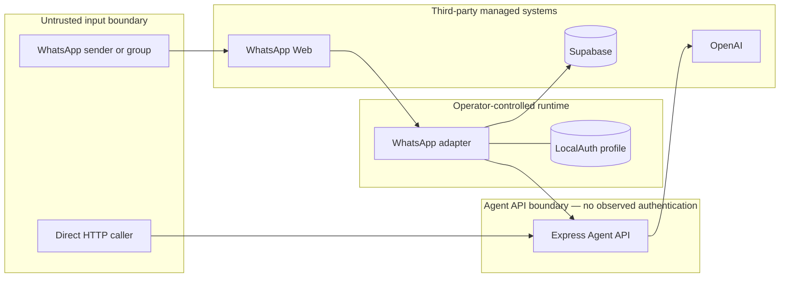

# Threat model

## Purpose and handling rule

This public threat model documents risk classes visible from the pinned source. It intentionally excludes session contents, credentials, database data, exploit payloads, and reproduction instructions. “Unknown” means the repositories do not provide enough evidence to confirm a control.

## Assets

- WhatsApp linked-device session and account access
- User and group messages, selected personas, and conversation history
- Uploaded knowledge and OpenAI file/vector-store objects
- Supabase and OpenAI credentials
- Model, web-search, storage, and bandwidth budget
- Service availability and operator control of the bot

## Trust boundaries

## Threat register

| ID | Severity | Threat | Evidence and impact | Control status |
| --- | --- | --- | --- | --- |
| T-01 | Critical | WhatsApp session material is present in public Git history | The LocalAuth/Chromium profile is committed while ignore rules are commented. Session compromise could expose the linked WhatsApp account. | No repository control observed |
| T-02 | Critical | Agent API accepts unauthenticated expensive and state-changing requests | Chat and knowledge endpoints have no authentication or authorization middleware. A caller can supply arbitrary `userId` values and consume model, search, file, and vector-store budget. | Missing in source |
| T-03 | High | Tenant isolation is not enforced for knowledge | All uploads target one configured vector store. Caller-provided metadata is not an authorization boundary. Future retrieval from that store could mix tenant content. | Missing in source |
| T-04 | High | Supabase data isolation is unknown | The adapter uses an anon key and caller-derived JIDs, but migrations and RLS policies are absent. Cross-user impact depends on unobserved database policy. | Unknown |
| T-05 | High | Upload and prompt resource exhaustion | Multer buffers files in memory; file size, text size, history length, request rate, and timeouts are not bounded. | Missing in source |
| T-06 | High | Browser process runs without Chromium sandbox controls | Puppeteer is started with `--no-sandbox` and `--disable-setuid-sandbox`, increasing impact of browser compromise on the host. | Explicitly disabled |
| T-07 | Medium | Conversation privacy and cost grow without retention bounds | All history for the JID is read and forwarded on every message. There is no deletion or retention path. | Missing in source |
| T-08 | Medium | Database failures can be treated as valid empty state | Supabase helper results do not inspect returned errors. Users may receive misleading state while operations fail. | Missing in source |
| T-09 | Medium | Temporary knowledge files may remain after partial failure | Text cleanup is on the success path rather than a `finally` path. | Partial |
| T-10 | Medium | Operational failures are difficult to detect and attribute | No health endpoints, correlation IDs, structured redaction, metrics, alerting, or CI is observed. | Missing in source |

## STRIDE summary

| Category | Primary exposure |
| --- | --- |
| Spoofing | Request-body `userId` and unauthenticated Agent API callers |
| Tampering | Unauthenticated knowledge ingestion into a shared configured store |
| Repudiation | No correlation or audit trail tying API activity to an authenticated actor |
| Information disclosure | Public session artifacts, unknown RLS, shared knowledge boundary |
| Denial of service | Unbounded upload, history, web-search, and model operations |
| Elevation of privilege | Session takeover and browser sandbox reduction |

## Security acceptance boundary

This repository is documentation-only and does not remediate source systems. It must never copy sensitive artifacts from the source repositories. Before any production claim, all P0 items in the [remediation backlog](remediation-backlog.md) require implementation and independent verification in the relevant source repositories.
